# Alegra Nómina: estudio para Medoxigas Contabilidad

Inspiración, no copia. Fuente: cuenta de prueba de Waldy (empresa "Fiel Ferreteria", RNC 131052436, RD), recorrida el 20 nov 2026.
Base: https://nomina.alegra.com — app separada de Alegra Contabilidad (`app.alegra.com`), mismo login, misma empresa.
Capturas en `capturas/`; extracciones de diseño en `design/` (ver `DESIGN-ALEGRA-NOMINA.md`).

## 1. Mapa de menús (Alegra Nómina)

Menú lateral fijo:

| Pantalla | URL | Qué tiene |
|---|---|---|
| Inicio | /home | Saludo, checklist de onboarding (4 pasos), tarjeta "Periodo a calcular", gráficas Costo vs Pago e Indicadores RD |
| Bandeja de entrada | /inbox | Tabs Principal / Novedades / Archivo; actividades, recordatorios y avisos |
| Empleados | /employees | Lista, Exportar, Nuevo empleado (manual / Excel / desde contrato) |
| Nómina → Cálculo de nómina | /liquidation | Lista de periodos, "Calcular nómina" |
| Nómina → Gestión de envíos | /liquidation/payment-stubs | Historial de colillas enviadas por email |
| Pagos | /payments | Registro contable de pagos de nómina |
| Suscripciones | → mi.alegra.com | Planes (solo lectura en este estudio) |
| Configuración | /configuration | Empresa, contable, ingresos, deducciones, numeraciones |
| Usuarios | → mi.alegra.com/users | Gestión de usuarios (otra app) |

Banner permanente: "Te quedan 7 días gratis / Elegir plan".

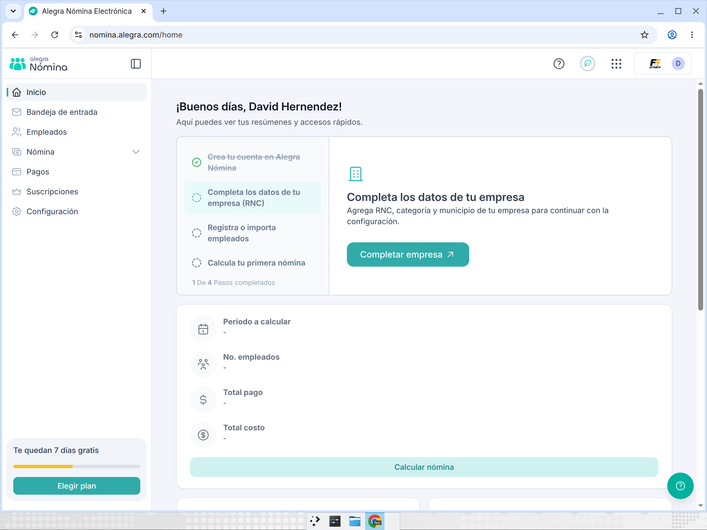

## 2. Onboarding y Configuración

### 2.1 Modal de bienvenida (datos de empresa)

Al entrar por primera vez aparece un modal pidiendo: Nombre de la empresa, Tipo (Persona jurídica/física), RNC, Municipio, Riesgo laboral, Método de pago por defecto. Detalle: el modal **no persistió todo** — hubo que re-entrar por Configuración → Empresa → Editar.

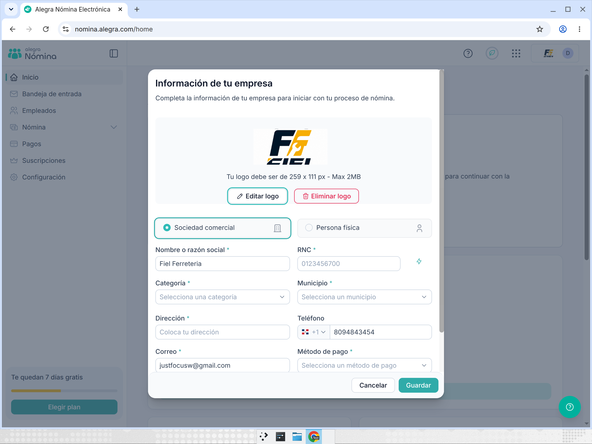

### 2.2 Configuración → Empresa (/configuration/company/edit)

- Persona jurídica, RNC 131052436, "Fiel Ferreteria"
- Riesgo laboral: **Riesgo Tipo I** (determina la tasa SRL)
- Tamaño: Empresa pequeña (afecta INFOTEP)
- Municipio: Santo Domingo de Guzmán
- Pago por defecto: Transferencia → Banco Popular / Corriente
- Frecuencia de nómina por defecto: Quincenal

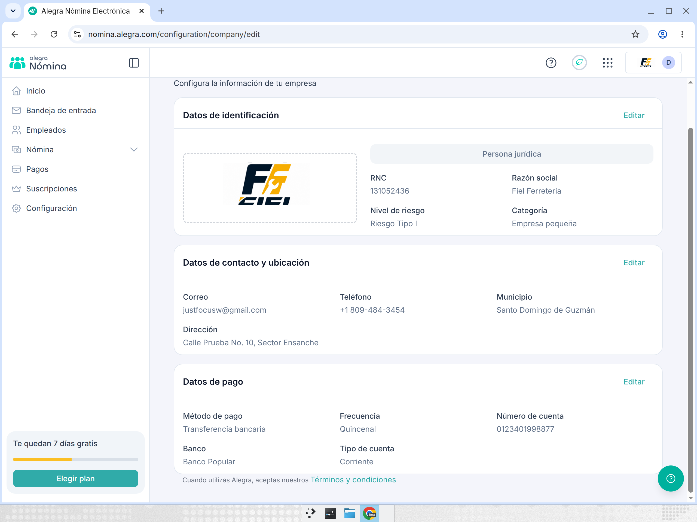

### 2.3 Configuración → Contable (/configuration/accounting)

Mapeo concepto → cuenta contable del catálogo de Alegra Contabilidad (esta integración es la que alimenta los comprobantes NO):

- **Ingresos**: Sueldos y salarios, Horas extras, Comisiones, Bonificaciones, etc.
- **Deducciones**: Retenciones SFS, AFP, ISR, préstamos…
- **Provisiones/cargas patronales**: Aportes AFP empleador, SFS empleador, SRL, INFOTEP, cesantía, preaviso, navidad…

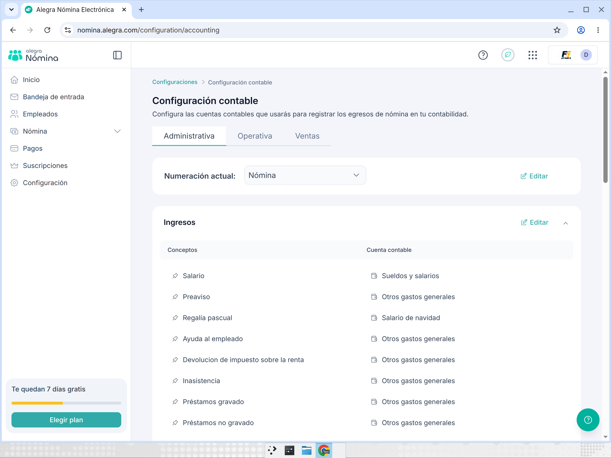 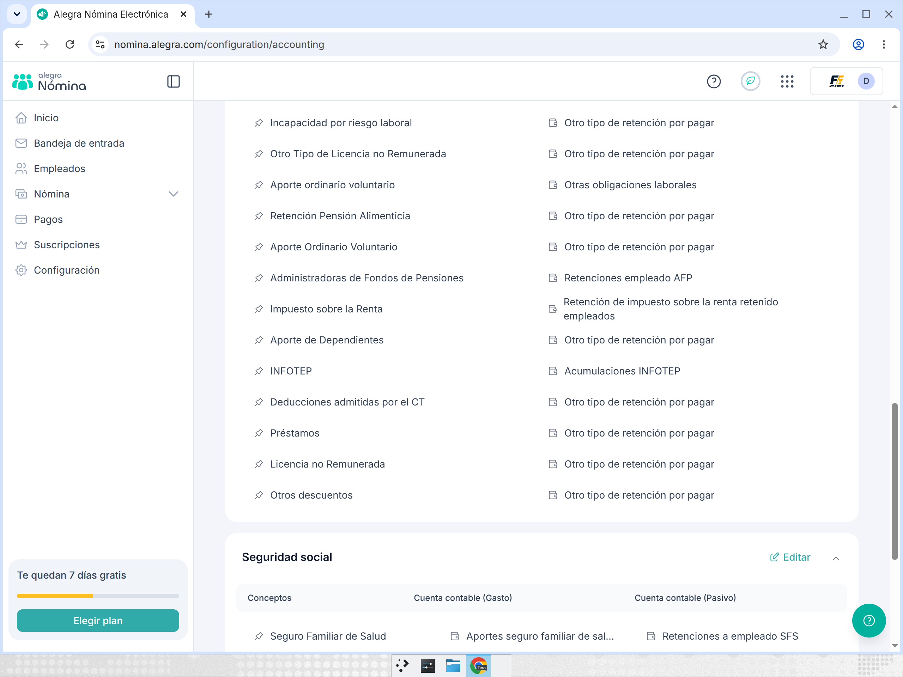 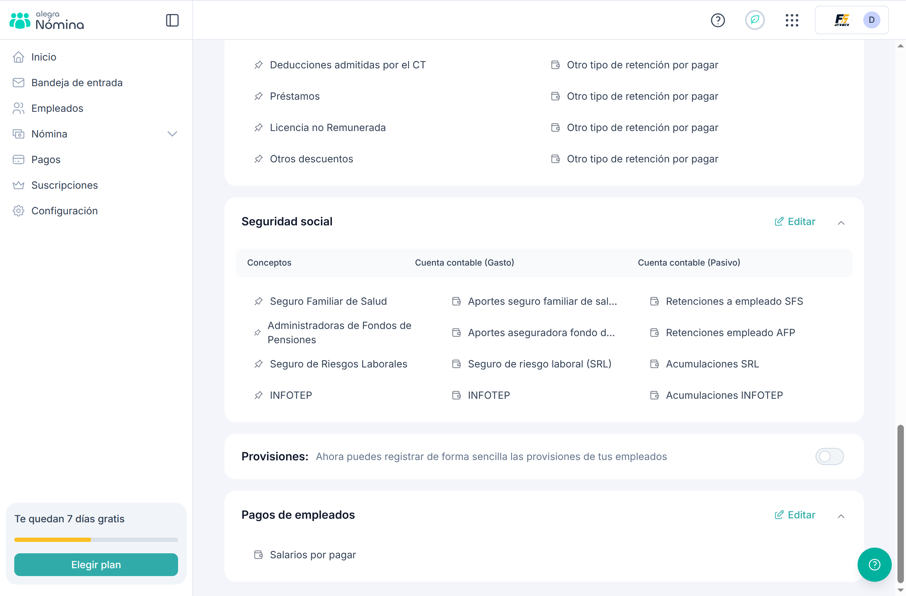

### 2.4 Configuración → Ingresos (/configuration/incomes)

18 conceptos predefinidos: Salario, Comisión, Diferencial Vacaciones Ley, Prima Nocturna, Horas Extra 35%, Horas Extra 100%, Otros Ingresos, Bonificación, Cesantías, Preaviso… + "Nuevo ingreso" personalizado.

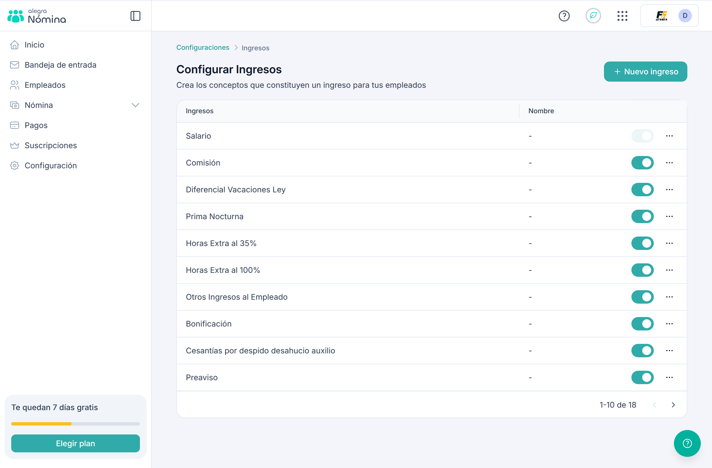

### 2.5 Configuración → Deducciones (/configuration/deductions)

15 predefinidas: SFS, AFP, ISR, Aporte de Dependientes, INFOTEP, Deducciones CT, Préstamos, Licencia no Remunerada, Otros descuentos, Licencia médica… + "Nueva deducción".

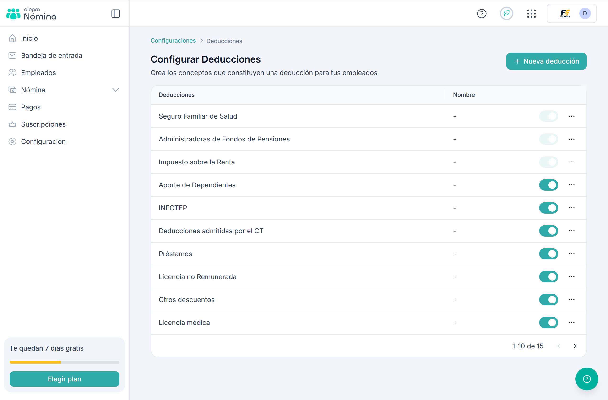

### 2.6 Configuración → Numeraciones (/configuration/numerations)

Una numeración "Nómina": prefijo N, próximo 1, Preferida=Sí, Activa. Es la que enumera los comprobantes contables (NO-1, NO-2…).

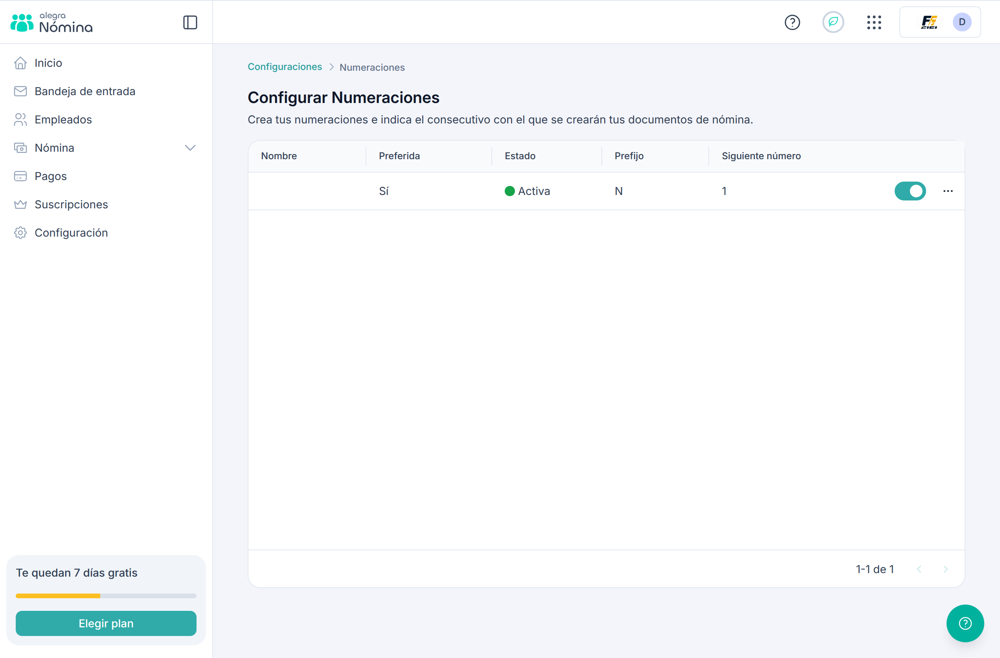

## 3. Empleados (/employees)

Lista: columnas Nombre, Cargo, Identificación, Salario, Estado; tabs **Activos / Suspendidos**; contador de plan ("Plan Demo 5/ilimitado"); Filtrar; **Exportar empleados**; **Nuevo empleado** → 3 opciones: Agregar manualmente / Importar desde Excel / Agregar desde contrato.

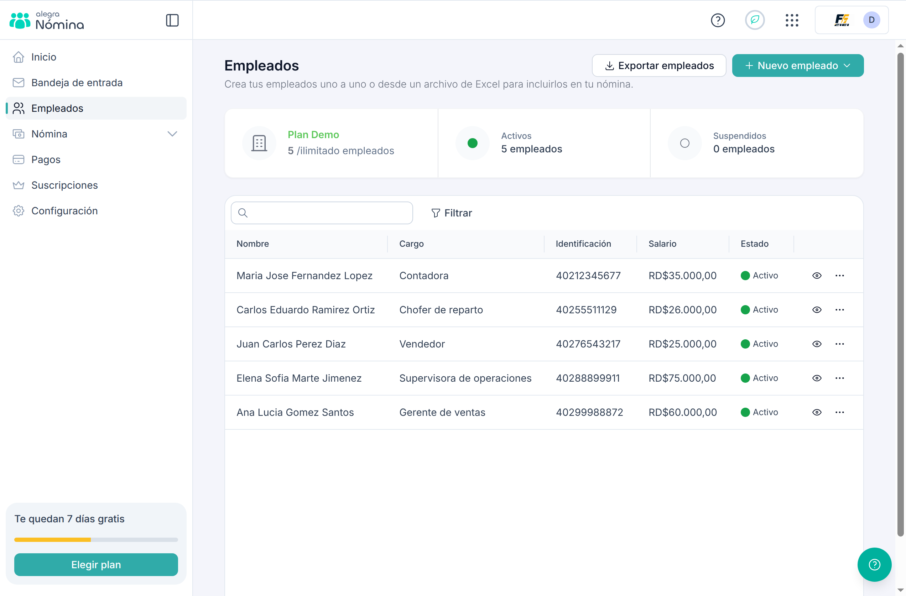

### 3.1 Alta manual — wizard de 3 pasos (/employees/new)

**Paso 1 – Datos principales:** Tipo ID* (Cédula/Pasaporte/Residencia Temporal), Número*, Primer nombre*, Segundo nombre, Primer apellido*, Segundo apellido, Municipio* (lista RD), Dirección*, Teléfono* (+1 con selector de país), Correo*. La cédula se valida con dígito verificador.

**Paso 2 – Condiciones contractuales:** Tipo de contrato* (Tiempo Definido → pide Fecha fin* / Indefinido), Fecha de contratación* (datepicker dd/mm/yyyy), Frecuencia de pago* (Quincenal/Mensual), Valor salario* (máscara RD$), Jornada* (Diurna/Nocturna/Mixto), TSS Clave nómina* (3 dígitos), Cargo* (texto libre), Área* (Administrativa/Operativa/Ventas — **coinciden con los segmentos de la contabilidad**).

**Paso 3 – Forma de pago:** Método* → si "Transferencia bancaria" aparecen Número de cuenta*, Banco* (18 bancos RD), Tipo de cuenta* (Ahorros/Corriente). Botones "Guardar" y "Guardar y crear nuevo".

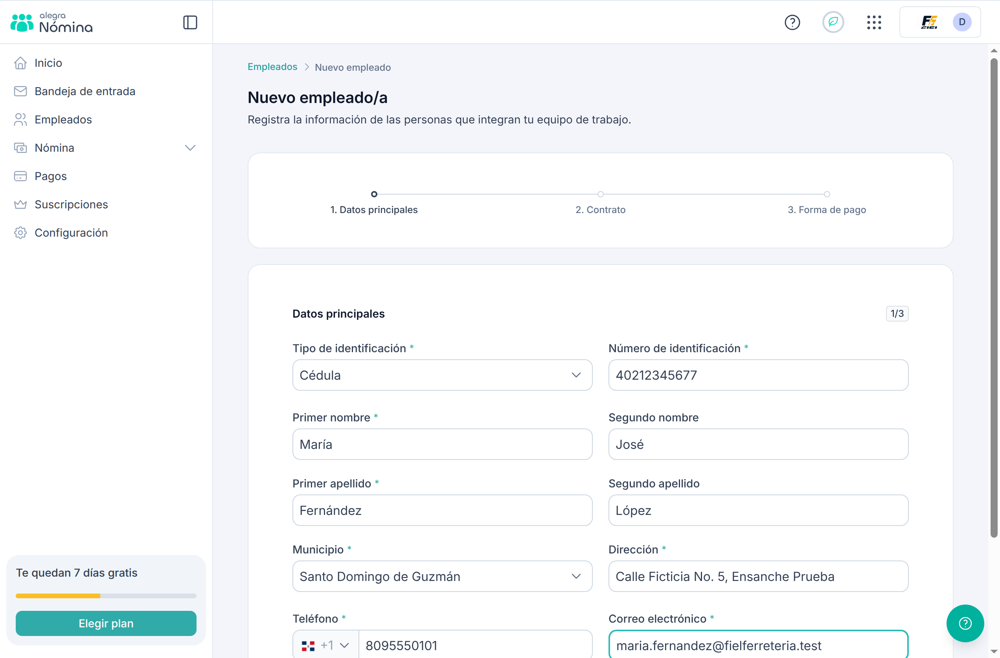 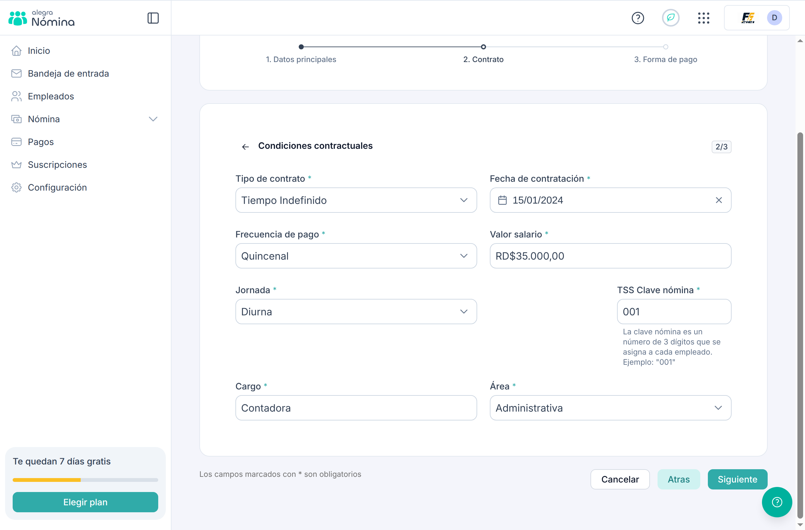 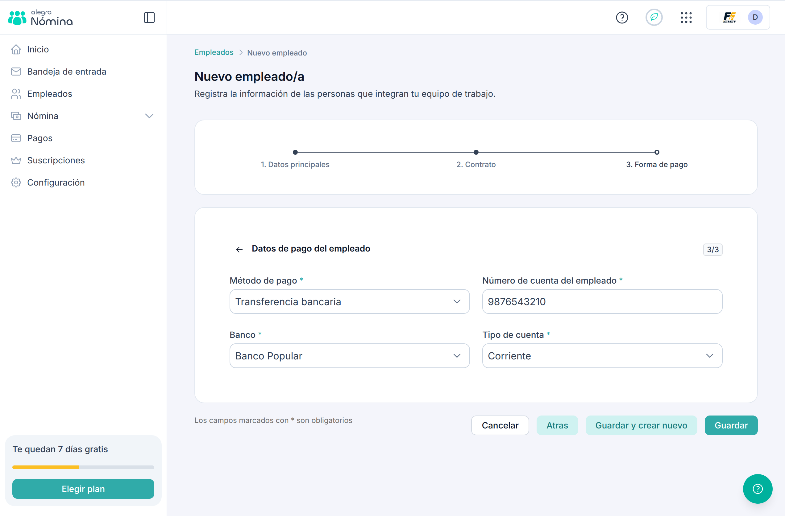

### 3.2 Importación masiva

Modal con dos tabs: **Importar archivo** (plantilla `.xlsx` descargable; hasta 100 empleados/archivo; .xlsx/.xls/.csv máx 500 MB) y **Editor en línea** (grid editable tipo Excel).

Columnas de la plantilla: Primer Nombre*, Segundo Nombre, Primer Apellido*, Segundo Apellido, Tipo identificación* (Cédula/Pasaporte/Residencia Temporal/RNC), Número*, Sexo y Fecha nacimiento (si Pasaporte), Clave Nómina* (TSS), Municipio*, Dirección*, Teléfono*, Correo*, Tipo contrato* (Tiempo Definido/Indefinido), Fecha inicio*, Fecha fin (si no indefinido), Jornada*, Salario*, Frecuencia* (Quincenal/Mensual), Cargo*, Área, Método pago* (Efectivo/Transferencia bancaria/Cheque/Transferencia internacional/Depósito), Banco*/Tipo cuenta*/Número cuenta* (solo si transferencia).

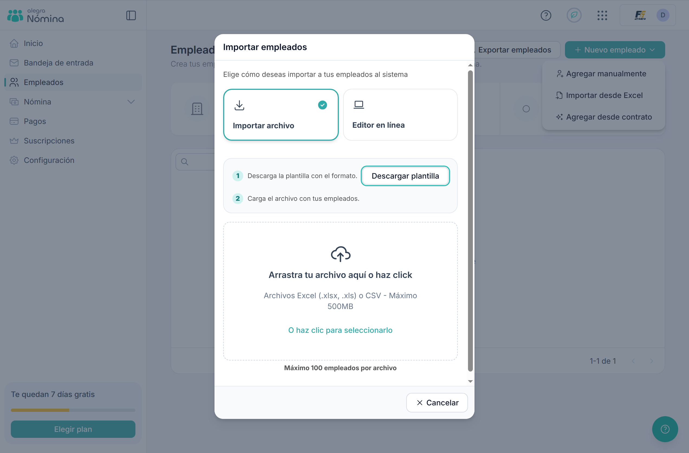 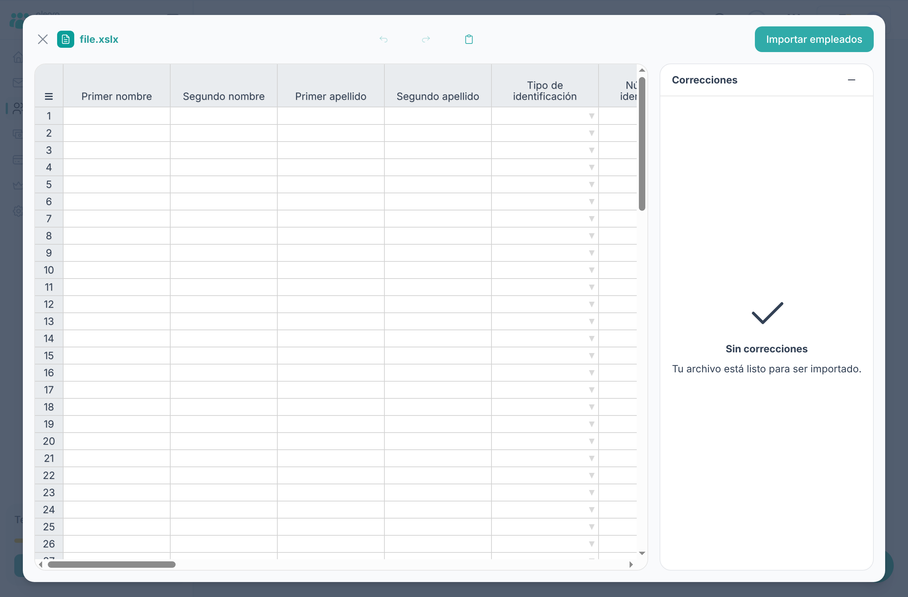

### 3.3 Ficha del empleado (/employees/detail/\<id>)

Encabezado: avatar, nombre, estado, botón **Nueva novedad**, tarjetas Inicio de labores / Tiempo laborado (días) / Cargo / Salario.

Tabs:
- **Información general**: secciones Datos principales, Datos salariales (salario base + método de pago), Condiciones contractuales — cada una con "Editar" propio.
- **Novedades recurrentes**: totales + "Agregar ingreso" / "Agregar deducción" → panel lateral (concepto, monto, periodo de inicio obligatorio). Las novedades recurrentes se aplican solas en cada periodo.
- **Historial**: sub-tabs Nómina / Novedades.

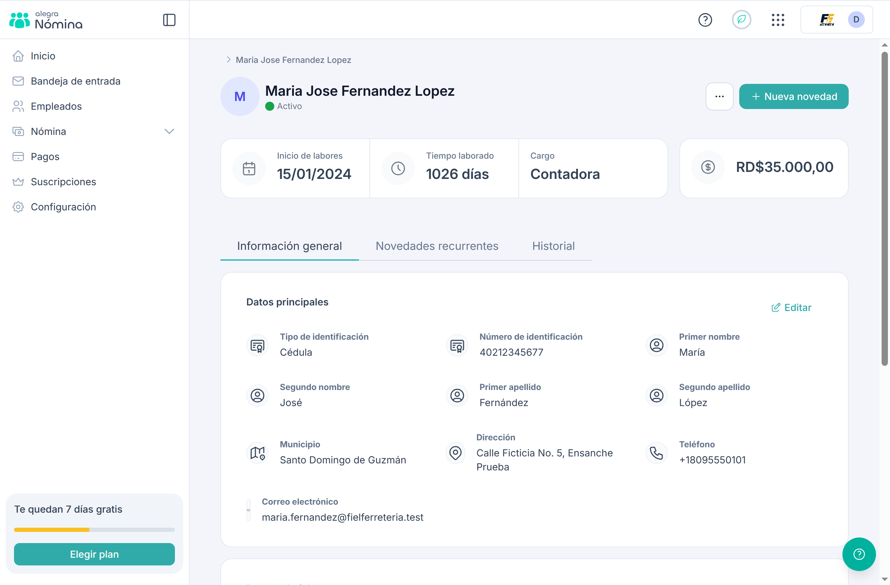 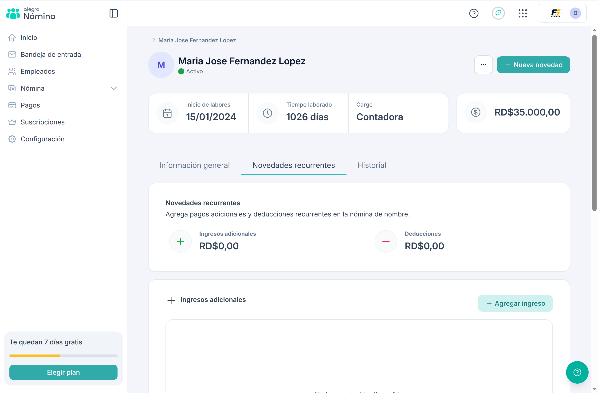 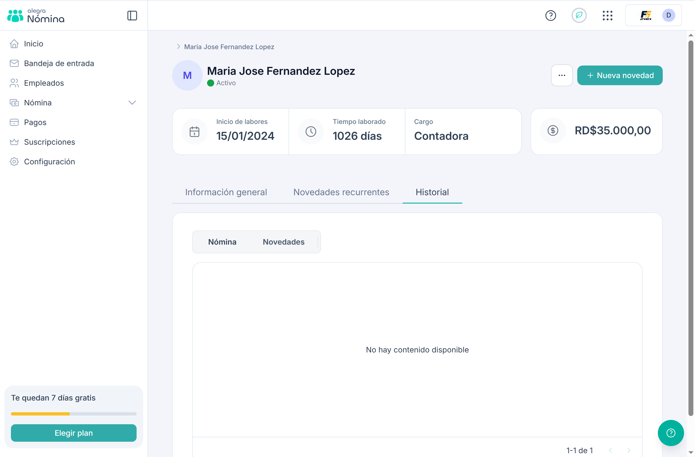 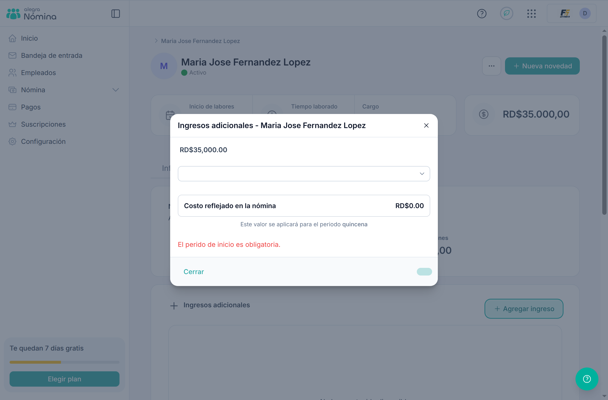

Bug observado: en la ficha, "Frecuencia de pago" aparece vacía aunque se eligió al crear.

Empleados creados en la prueba:

| Nombre | Cargo | Salario | Frecuencia | Pago | Contrato |
|---|---|---|---|---|---|
| María José Fernández López | Contadora | 35,000 | Quincenal | Transferencia Popular | Indefinido |
| Juan Carlos Pérez Díaz | Vendedor | 25,000 | Mensual | Efectivo | Tiempo Definido |
| Ana Lucía Gómez Santos | Gerente de ventas | 60,000 | Quincenal | Cheque | Indefinido |
| Carlos Eduardo Ramírez Ortiz | Chofer de reparto | 26,000 | — | — | — |
| Elena Sofía Marte Jiménez | Supervisora operaciones | 75,000 | — | — | — |

## 4. Ciclo de Nómina (/liquidation)

### 4.1 Crear periodo

"Calcular nómina" → modal con **Periodo*** (typeahead: escribes el mes —"Nov"— y lista sus quincenas: "1 Nov - 15 Nov", "16 Nov - 30 Nov") + año. Aviso: "podrás editar los datos de los empleados que incluirás".

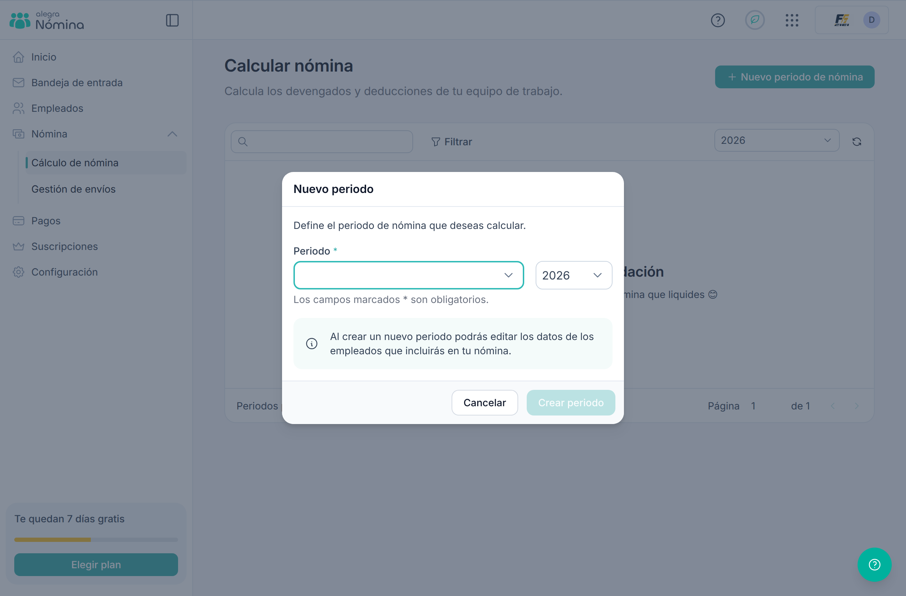 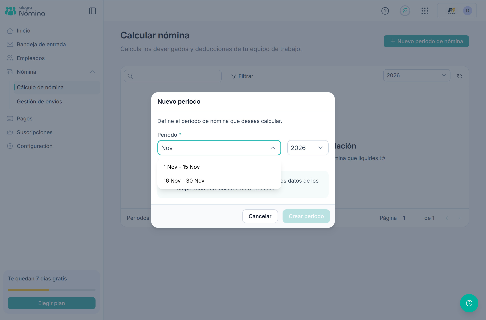

Regla: el periodo **solo incluye empleados de esa frecuencia** — la quincena trajo a María y Ana; Juan (mensual) quedó fuera.

### 4.2 Pantalla del periodo (/liquidation/period/from/…/to/…)

Header: botones **Enviar recibos**, **Contabilizar**, **Calcular nómina**, **Añadir empleados**. Barras de progreso **Cálculos %** y **Contabilización %**. Resumen: Empleados, Ingresos adicionales, Deducciones, **Total a pagar**. Tabla por empleado con Cargo/Departamento/Salario/Método + estado (Por calcular → Calculada → Contabilizada).

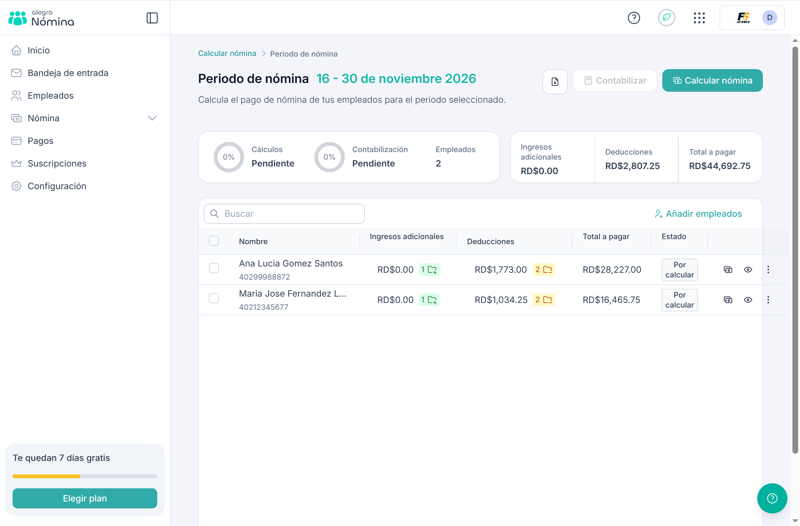

### 4.3 Recibo de pago (/liquidation/payroll/\<id>)

Clic en la fila del empleado → recibo con:
- Encabezado: empresa (nombre, NIT, municipio, correo) + empleado (cédula, dirección, correo)
- Fechas inicio/fin del cálculo, Medio de pago
- **Días calculados: 11.915** — la quincena se prorratea por días trabajados ("se liquidan únicamente los días trabajados")
- Resumen de pago: Salario / Ingresos adicionales / Deducciones / Total
- Tablas de Ingresos (Concepto/Cantidad/Valor) y Deducciones (Concepto/Porcentaje/Valor)

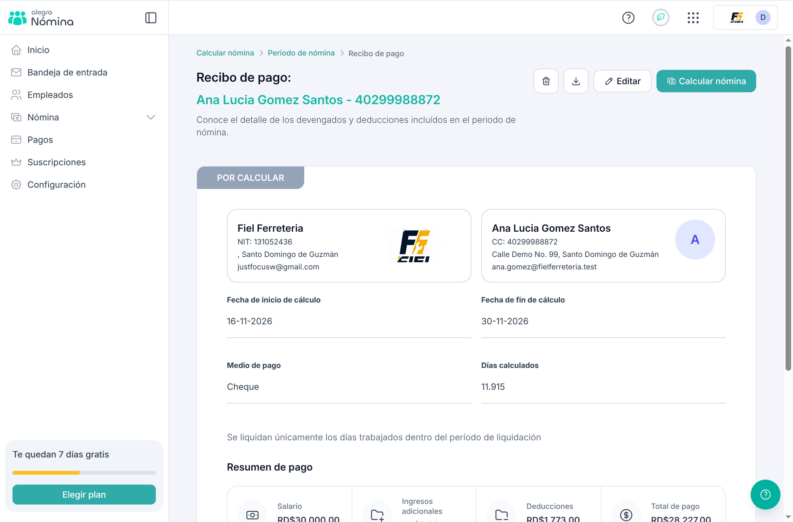

### 4.4 Novedades (editar recibo)

"Editar" → filas editables + "Agregar ingreso" / "Agregar deducción" (los conceptos de Configuración). Validación: el campo Valor hay que escribirlo con decimales ("1500.00") o da "El valor debe ser mayor a 0" y bloquea Guardar.

**Horas Extra al 35% autocalcula**: `salario_mensual / 23.83 / 8 × 1.35 × horas`. 5 h sobre RD$60,000 → RD$2,124.42 (fórmula oficial RD).

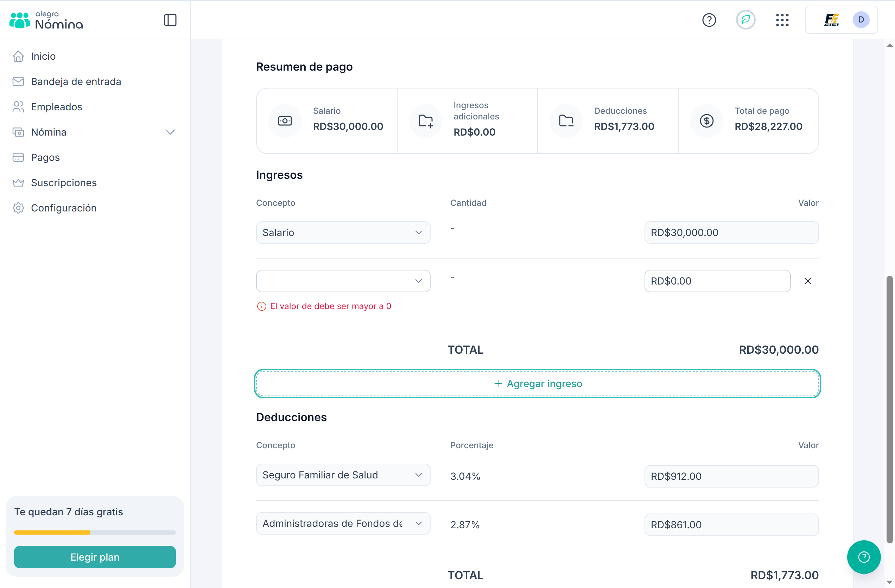 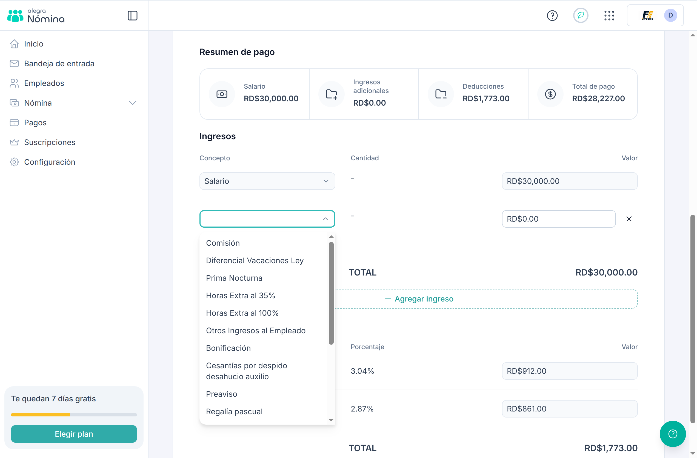 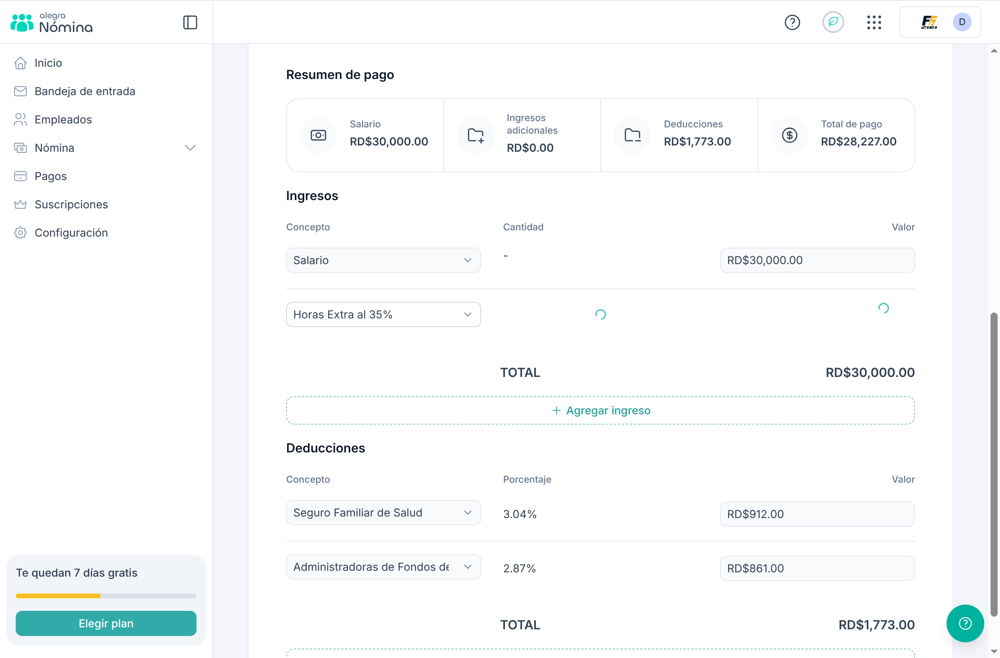

Detalle: las retenciones SFS/AFP se calcularon sobre el salario base (30,000), sin incluir horas extra en la base TSS visible.

### 4.5 Liquidar y contabilizar

"Guardar y liquidar" → modal: "Estás por liquidar la nómina de 1 empleado… **Total a pagar / Total del costo**" (Total del costo = neto + cargas patronales + provisiones ≈ +57%). Confirmar → toast "Los datos se guardaron y liquidaron con éxito" → estado **Calculada**.

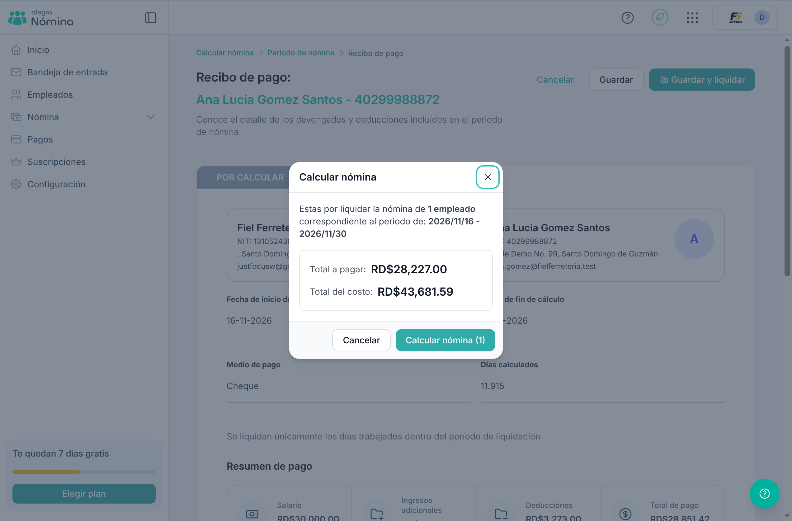

"Contabilizar nómina" → modal **Contabilidad inteligente**: "Cuentas contables: 1 Disponible"; incluye devengados + deducciones + provisiones; "Se creará un comprobante de nómina por cada empleado"; "Todas las cuentas contables de nómina se verán reflejadas en Alegra Contabilidad". Banner: "N comprobantes se están procesando en segundo plano".

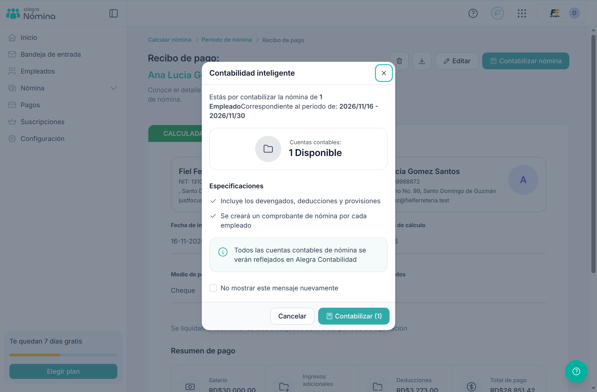 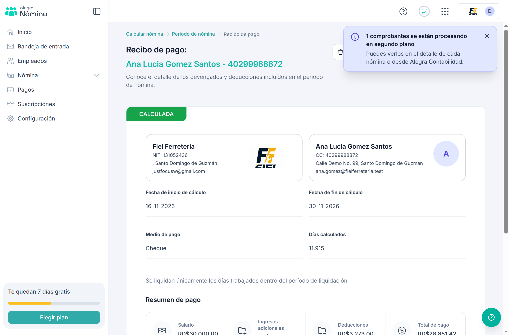

Nota: la contabilización es por empleado y asíncrona; si una queda "En proceso", el botón Contabilizar re-aparece con el conteo pendiente (ej. "Contabilizar (1)").

### 4.6 Envío de colillas y Gestión de envíos

"Enviar recibos" → modal **Colilla de pago**: lista empleados con correo + "Seleccionar todo" → "Enviar colilla de pago" → confirmación irreversible "Se enviarán los recibos de pago de N empleados" → el volante llega por **email**.

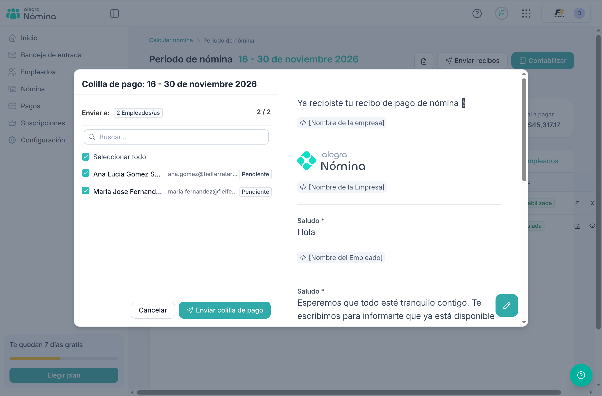

**Gestión de envíos** (/liquidation/payment-stubs): historial — Periodo | Fecha de envío | Empleados | Progreso | Estado → 16-30 nov | 20 nov 2026 | 2 | 2/2 | **Enviado**.

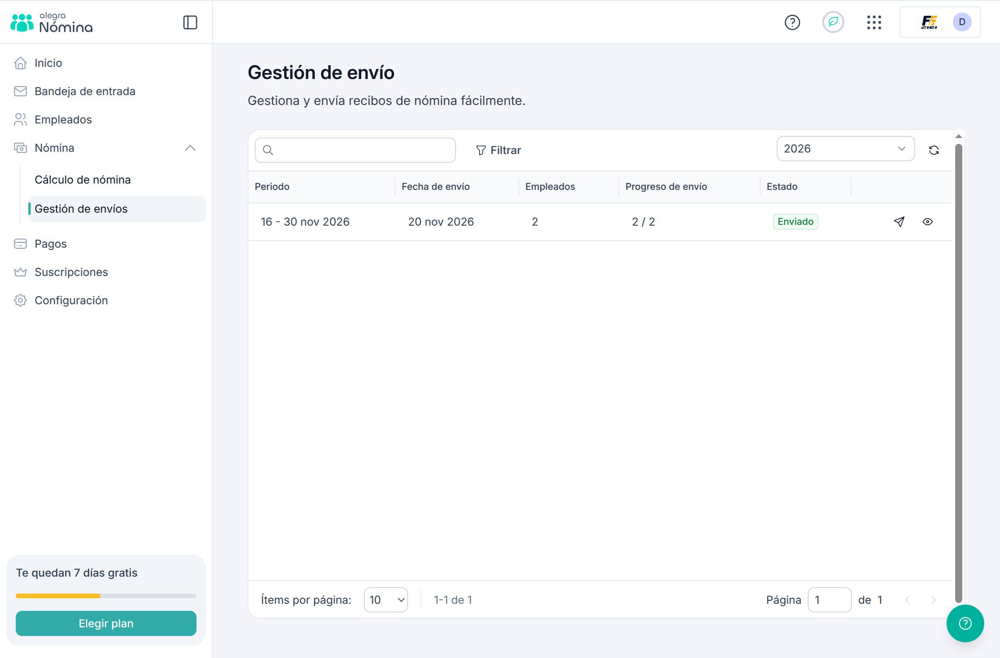

## 5. Pagos (/payments)

"Registro de pagos — realiza el registro contable de los pagos de nómina". Tabla por periodo: Salario | Ingresos adicionales | Deducciones | **Total a pagar** | **Total costo** → 47,500 | 2,124.42 | 4,307.25 | 45,317.17 | **70,368.97**.

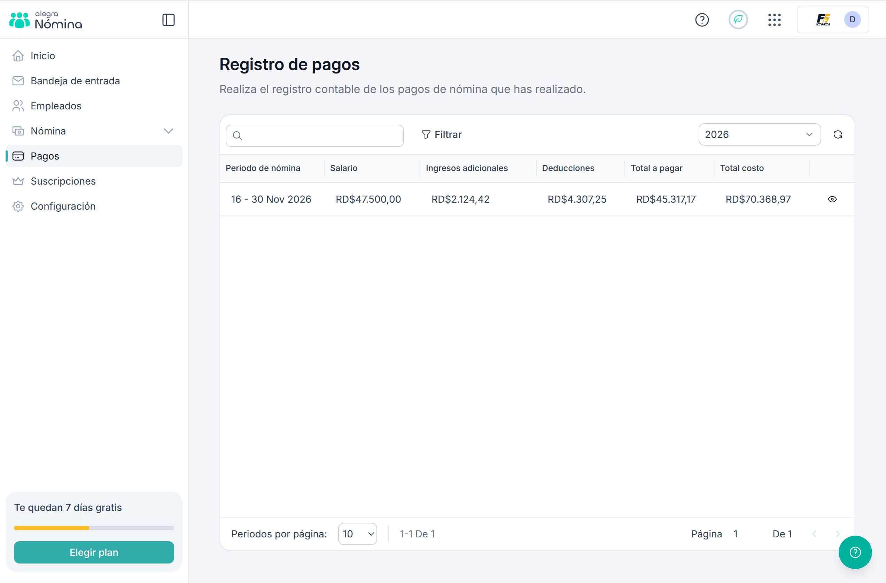

Detalle (ícono ojo) → filas por empleado con estado "Por pagar", botón "Pagar todo" y un ícono de pago individual por fila:

- **Pago individual** → modal "Pagar nómina": Fecha de pago + **Cuenta bancaria*** (desplegable con las cuentas de Alegra Contabilidad: Banco Popular Prueba, Caja general, Caja chica, POS, tarjeta…) → "Pagar" → estado **Pagado**.
- **Regla habilitadora**: el botón de pago (individual y "Pagar todo") queda **deshabilitado hasta que la nómina del empleado esté "Contabilizada"**. María no se podía pagar mientras estaba "Calculada".
- No se encontró generación de archivo TXT de dispersión bancaria en la UI: el flujo es registro contable del pago (mueve Bancos en Alegra Contabilidad).

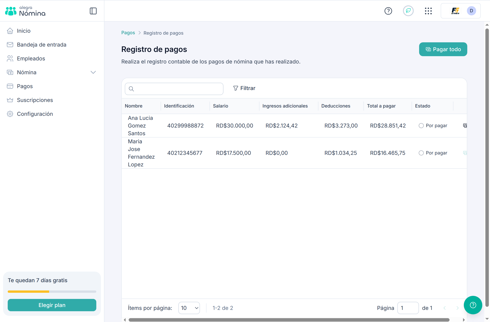 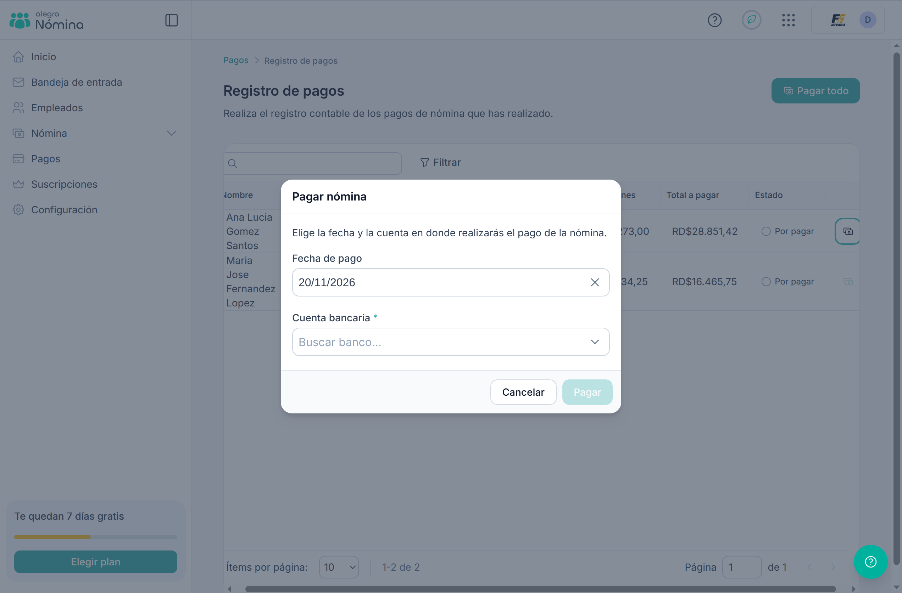 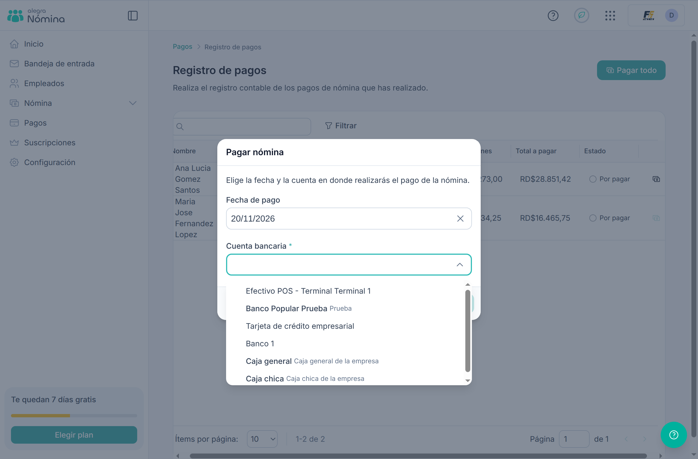 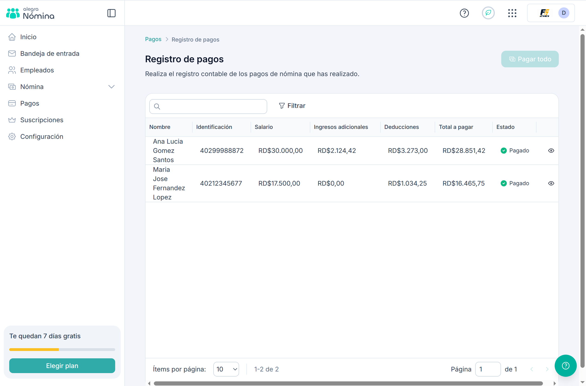

## 6. Cómo se registra en Alegra Contabilidad (app.alegra.com)

Verificado: los comprobantes llegan a **Contabilidad → Entrada de diario** (`/ledger/documents`):

| Tipo | Numeración | Fecha | Estado | Total |
|---|---|---|---|---|
| NO | NO-1 | 30/11/2026 | Abierto | RD$ 37,011.42 |
| NO | NO-2 | 30/11/2026 | Abierto | RD$ 20,350.75 |

Tipo "Nómina (NO)", numeración "Nómina", observaciones "Ref-2026", **un comprobante por empleado** (no uno consolidado).

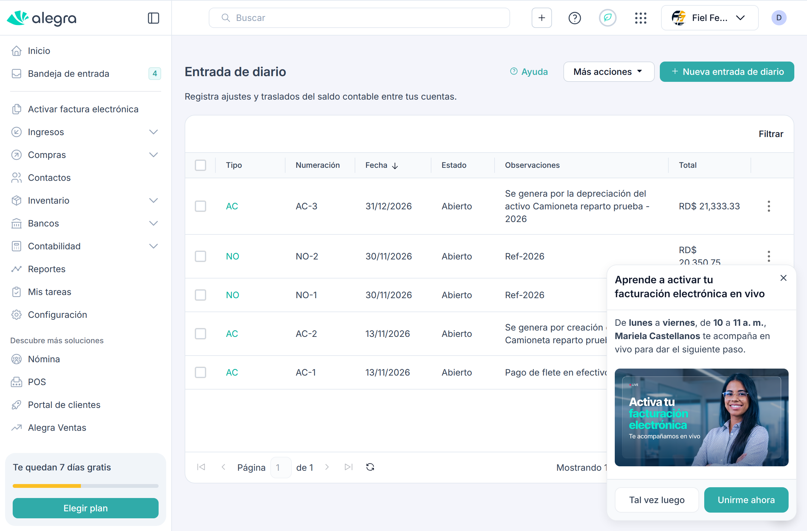

NO-1 (Ana) — débitos y créditos exactos:

| Cuenta | Contacto | Descripción | Débito | Crédito |
|---|---|---|---|---|
| INFOTEP | INFOTEP | INFOTEP | 300 | |
| Seguro de riesgo laboral (SRL) | TSS | SRL | 330 | |
| Aportes aseguradora fondo de pensiones | TSS | AFP empleador | 2,130 | |
| Aportes seguro familiar de salud (SFS) | TSS | SFS empleador | 2,127 | |
| Horas extras | Empleado | Horas Extra 35% | 2,124.42 | |
| Sueldos y salarios | Empleado | Salario | 30,000 | |
| Retenciones a empleado SFS | TSS | SFS 3.04% | | 912 |
| Retenciones empleado AFP | TSS | AFP 2.87% | | 861 |
| Otro tipo de retención por pagar | Empleado | Préstamos | | 1,500 |
| Retenciones a empleado SFS | TSS | Aporte empleador | | 2,127 |
| Retenciones empleado AFP | TSS | Aporte empleador | | 2,130 |
| Acumulaciones SRL | TSS | SRL | | 330 |
| Acumulaciones INFOTEP | INFOTEP | INFOTEP | | 300 |
| Salarios por pagar | Empleado | Salario por pagar | | 28,851.42 |
| **Total** | | | **37,011.42** | **37,011.42** |

Lógica: débito = gastos (sueldos + horas extra + aportes patronales + provisiones); crédito = retenciones del empleado + provisiones por pagar + préstamo + **Salarios por pagar (neto)**. Contactos automáticos: "Tesorería de la Seguridad Social", "Instituto Nacional de Formación Técnico Profesional", el propio empleado.

⇒ **Sí se ve en la contabilidad general**: las entradas NO alimentan Libro diario y los estados contables, línea por línea según el mapeo de Configuración → Contable. El registro de pago mueve Bancos (no verificable con perfil limitado: "Tu usuario tiene un perfil limitado").

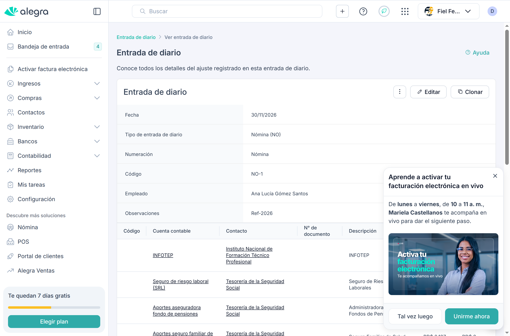

## 7. Tasas y fórmulas RD verificadas

| Concepto | Tasa | Base |
|---|---|---|
| Retención SFS empleado | 3.04% | Salario del periodo |
| Retención AFP empleado | 2.87% | Salario del periodo |
| Aporte SFS empleador | 7.09% | idem |
| Aporte AFP empleador | 7.10% | idem |
| SRL | ~1.1% | según Riesgo Tipo I |
| INFOTEP | 1% | empresas que aplican |
| Quincena | salario mensual / 2 | |
| Días calculados | prorrateo (11.915 días en 16-30 nov) | días trabajados |
| Hora extra 35% | salario / 23.83 / 8 × 1.35 | fórmula oficial |

Indicadores 2026 mostrados en Inicio: Salario mínimo RD$23,223.00; tope AFP RD$464,460.00; tope SFS RD$232,230.00; tope SRL RD$92,892.40 (anuales).

## 8. Inicio, Bandeja y Suscripciones

- **Inicio** post-nómina: checklist "0 de 4 pasos" (no se marca pese a tener todo hecho — posible bug), tarjeta "Periodo a calcular" vacía, gráficas aún sin series. Indicadores RD arriba.
- **Bandeja**: tabs Principal(4)/Novedades/Archivo — vacía en la prueba.
- **Suscripciones** (solo lectura): Plan actual **Demo**. Nómina Inicial **US$26/mes** (US$313/año, hasta 10 empleados) · Nómina Pro **US$53/mes** (US$637/año, hasta 40) · Nómina Plus **US$80/mes** (US$961/año, ilimitados). Todos: cálculo automatizado, contabilización automática con Alegra Contabilidad, reportes TSS, importación masiva. Anual −10%.

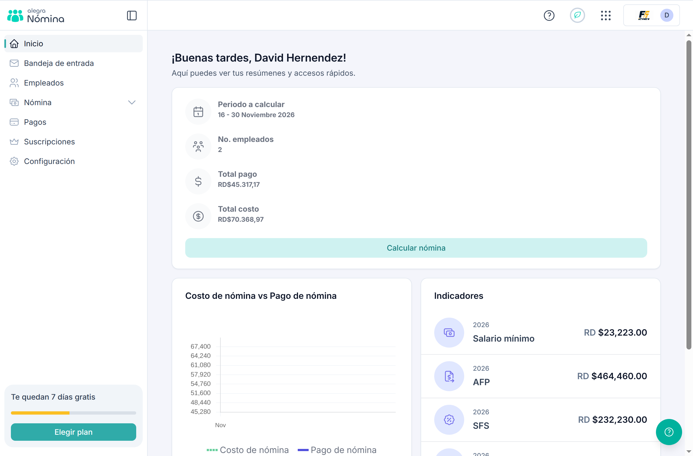 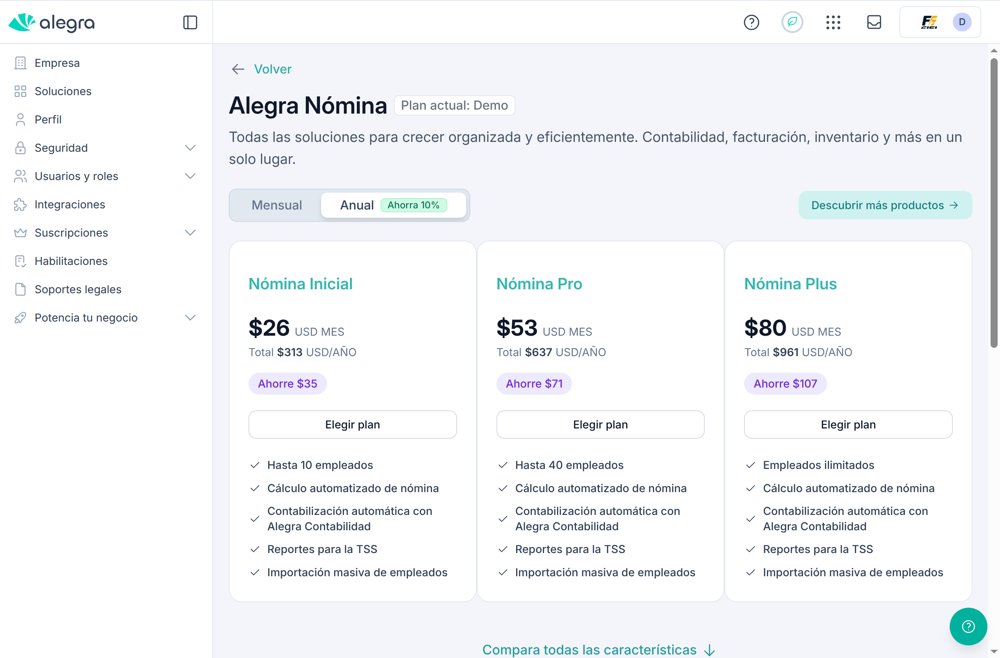

## 9. Aprendizajes para Medoxigas

- El ciclo es **estrictamente secuencial**: periodo → calcular → liquidar → contabilizar → pagar. El pago se bloquea sin contabilización — buen candado para replicar.
- Comprobante contable **por empleado** (no consolidado): más detalle y trazabilidad, pero más documentos.
- La contabilidad vive en otra app; Nómina solo mapea concepto→cuenta y dispara el comprobante. Equivalente nuestro: nómina dentro del mismo sistema → asiento directo al libro diario con las mismas partidas (devengados al débito, retenciones/aportes/provisiones y neto al crédito).
- Novedades recurrentes (ficha del empleado) vs novedades del periodo (editando el recibo): dos niveles que conviene mantener separados.
- La prorrata por días trabajados ("días calculados") es visible y explica diferencias entre empleados del mismo salario.
