# Reporte de investigación — Alegra Contabilidad (República Dominicana)

**Cuenta:** Fiel Ferreteria (plan demo, versión República Dominicana)
**Fecha de la prueba:** 19–20 de noviembre de 2026
**Método:** observación directa de la UI, del Libro diario / asientos generados por los documentos, y de los archivos exportados (ZIP con TXT pre-validador DGII + Excel). Los archivos exportados se abrieron con `openpyxl`/`cat` para verificar columnas y contenido real.
**Nota de fechas:** los archivos exportados llevan fecha "19-11-2026" en el nombre mientras que los documentos creados muestran creación "20/11/2026" y los asientos del producto se fecharon "19/11/2026" (diferencia de zona horaria observada en pantalla; se reporta tal como se vio).

## Datos de prueba creados (prefijo `PRUEBA-INV-`)

| Objeto | Valor | Observaciones |
|---|---|---|
| Producto `PRUEBA-INV-01` | Unidad "Unidad", Almacén "Principal", cantidad inicial 10, costo 500, precio 800, ITBIS 18% | Luego editado (cantidad/costo) |
| Contacto `PRUEBA-INV-CLI` | Cliente, tipo ID RNC `402123455` | ID válido (pasa dígito verificador DGII) |
| Contacto `PRUEBA-INV-PROV` | Cliente+Proveedor, RNC `132000013` | El primer RNC (`132000015`) fue **rechazado** por la validación de dígito verificador de Alegra; corregido |
| Factura de proveedor `B0100000051` | 1 ítem PRUEBA-INV-01 × RD$600 + ITBIS 108 | Generó el renglón real del 606 |
| Factura de venta `B0100000002` | 800 + ITBIS 144, retención ITBIS 30% (43.20), NC parcial 885.00 y pago efectivo 15.80 | Generó el renglón de retención/pago mixto del 607 |
| Factura de venta `B0100000003` | 800 + ITBIS 144, **fecha 15/10/2026** | Base de la NC >30 días |
| Factura de venta `B0100000004` | 800 + ITBIS 144, **anulada** | Generó el renglón del 608 |
| Nota de crédito `B0400000002` | 800 + ITBIS 144 aplicada a B0100000003 (>30 días) | Verificación regla 30 días |
| Nota de crédito `B0400000003` | 750 + ITBIS 135 aplicada a B0100000002 (mismo día) | Contraparte ≤30 días |
| Ajuste de inventario entrada N° 1 | 5 unidades × RD$700 | Eliminado posteriormente |
| Ajuste de inventario salida N° 2 | 2 unidades | Vigente |

**Cambios de configuración realizados (quedan en la cuenta de prueba):**
- RNC de la empresa configurado como `131999999` (era requisito para exportar 607).
- En *Reportes → Fiscales → configuración del reporte* (606): cuenta **Inventarios** → Categoría DGII "Compras y gastos que hacen parte del costo de venta", Tipo de compra "Bienes".
- En la misma página (607): cuentas **Ingresos de actividades ordinarias** y **Ventas** → Tipo de ingreso "Ingresos por operaciones (No financieros)".

---

## Prueba 1 — Producto nuevo con inventario inicial ✅ Verificado en pantalla

**Asiento automático generado.** Al guardar el producto (10 × 500), el Libro diario muestra el asiento **`II-10`**, fecha **19/11/2026**:

| Cuenta | Débito | Crédito |
|---|---|---|
| Inventarios | RD$5,000.00 | |
| Ajustes iniciales en inventario | | RD$5,000.00 |

- El asiento existe y sí se genera automáticamente por el valor de la carga inicial.
- La cuenta **"Inventarios"** es una cuenta automática del sistema: **sin código**, cuenta de movimiento, naturaleza Débito, ubicada en Activos corrientes (tiene la subcuenta "Inventario de mercancías"). **No es seleccionable** en el reporte *Movimientos por cuenta contable* (verificado: no aparece en el selector por ser automática y sin código).
- La cuenta **"Ajustes iniciales en inventario"** (Patrimonio > Ajustes por saldos iniciales) también es automática, sin código, naturaleza Crédito, con uso "Sin uso contable".

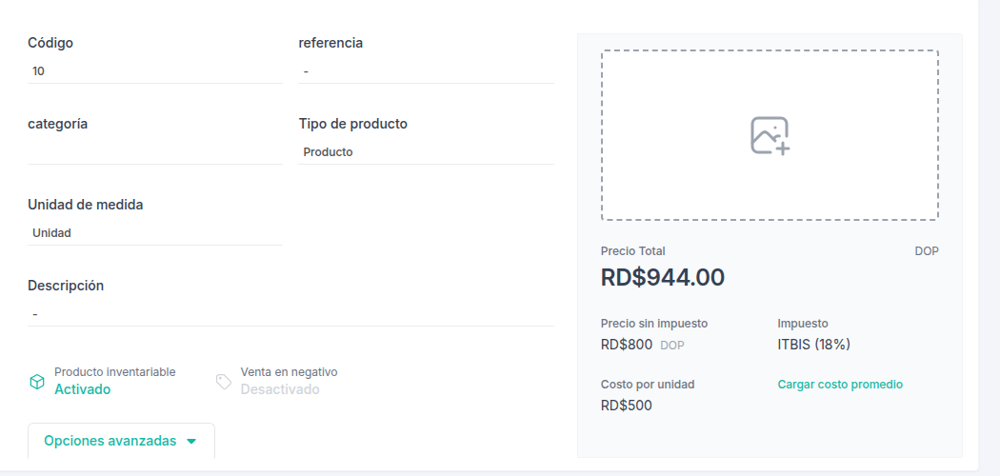

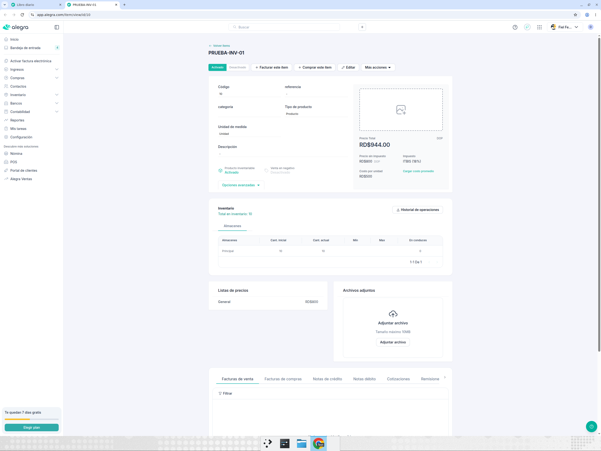

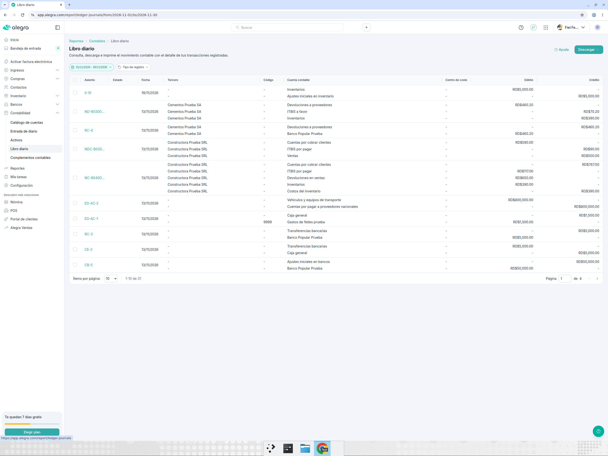

## Prueba 2 — Editar cantidad/costo de producto existente ✅ Verificado en pantalla

- Alegra **sí permite editar** la cantidad inicial y el costo unitario del producto ya creado (los campos no vienen bloqueados en el formulario de edición).
- **No se genera un asiento nuevo ni de ajuste.** El mismo asiento `II-10` (misma fecha 19/11/2026) se **modifica en el lugar**: su monto cambió de 5,000 → 6,000 → 9,000 a medida que se editaron cantidad (10→15) y costo (500→600) en guardados sucesivos, quedando RD$9,000 = 15 × 600.
- Es decir: la carga inicial es un asiento "vivo" que se recalcula con la ficha del producto, no una operación histórica con contrapartida de revalúo.

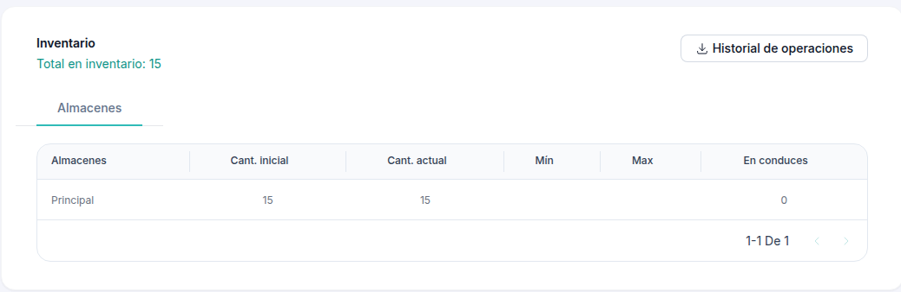

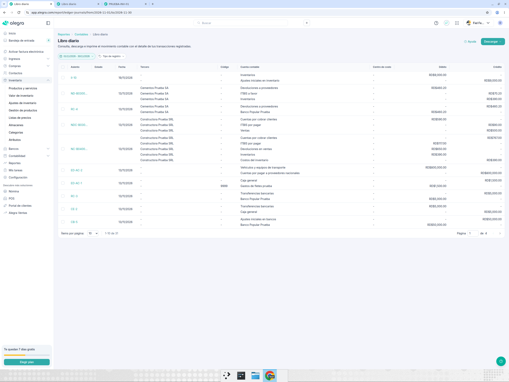

## Prueba 3 — Ajustes de inventario ENTRADA y SALIDA ✅ Verificado en pantalla

### ENTRADA: 5 unidades × RD$700 — asiento `AI-1`, 20/11/2026

| Cuenta | Cargo | Abono |
|---|---|---|
| Inventarios | RD$3,500.000000 | |
| Ajustes al inventario | | RD$3,500.00 |

- **Nota:** la contrapartida es **"Ajustes al inventario"** (cuenta distinta de "Ajustes iniciales en inventario" usada en la carga inicial).
- El campo costo de la entrada **sí es editable** (se escribió 700, distinto del promedio).
- Resultado: 20 unidades, **costo promedio RD$625.00** (12,500 / 20), valor de inventario RD$12,500.

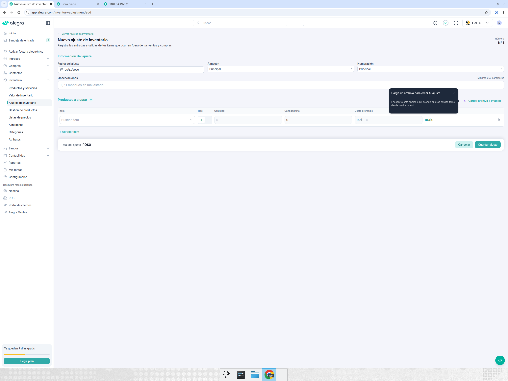

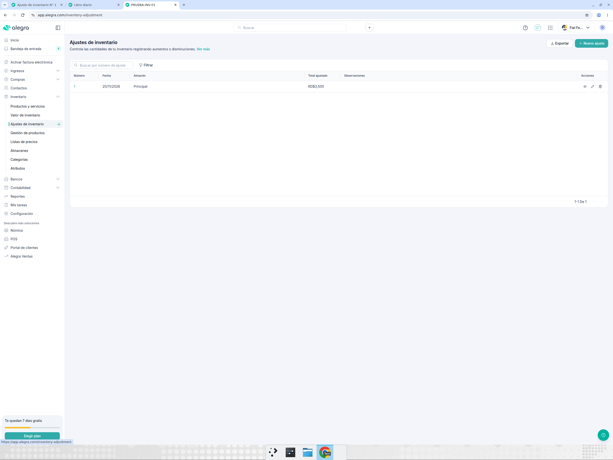

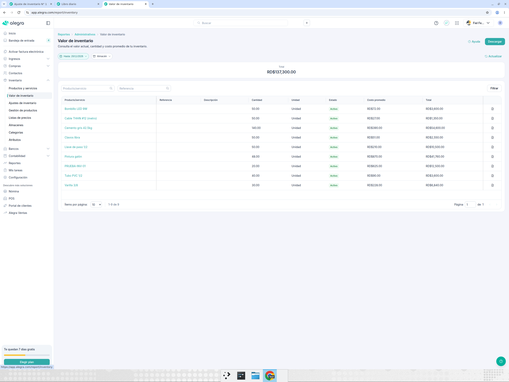

### SALIDA: 2 unidades — asiento `AI-2`, 20/11/2026

| Cuenta | Cargo | Abono |
|---|---|---|
| Ajustes al inventario | RD$1,250.00 | |
| Inventarios | | RD$1,250.00 |

- En la salida el campo costo **viene bloqueado al costo promedio vigente** (RD$625): al intentar escribir otro valor el campo lo rechaza; el ícono de lápiz junto al campo no permite editarlo. 2 × 625 = 1,250. Tras la salida: 18 unidades, promedio se mantiene RD$625, valor RD$11,250.

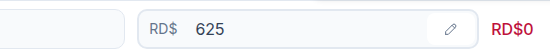

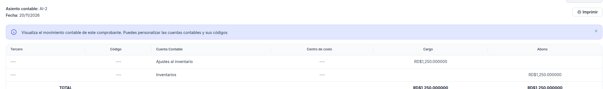

### Eliminación del ajuste de entrada

- Alegra **permite eliminar** el ajuste de entrada (botón eliminar en la lista de ajustes), con confirmación.
- Es un **borrado real** (no asiento de reversa): el asiento `AI-1` desaparece del Libro diario.
- Efecto en el ítem: cantidad 18 → **13 unidades**; valor 11,250 → **RD$7,750** (resta el valor originalmente posteado por el ajuste, 3,500); **costo promedio resultante RD$596.15** (7,750 / 13).
- **No restaura el promedio previo a la entrada** (que habría sido 600 con valor 7,800): revierte cantidad y monto posteado, y el promedio se recalcula con lo que queda.


## Prueba 4 — Reportes fiscales 606 / 607 / 608 ✅ Verificado en pantalla y en archivos

### Formatos disponibles (los tres reportes)

- Cada tarjeta (Reportes → Fiscales → Reporte 606/607/608) abre un **modal de exportación** con solo dos campos: **Periodo** y **Tipo de archivo** ("Archivo plano" o "Archivo excel"). **No hay vista/tabla en pantalla** con los renglones: el único "detalle" disponible es el archivo descargado.
- La descarga llega por **"Historial de exportables"** (conserva exportables de los últimos 15 días) como **ZIP** que contiene:
  - `Alegra - Reporte 60X - <empresa> -.txt` (o `.xlsx` si se eligió Excel), y
  - `Alegra - Documentos no incluidos - <empresa> -.xlsx` con los documentos excluidos y el motivo.
  - En el **608** el ZIP trae **solo** el archivo del reporte (sin archivo de excluidos).

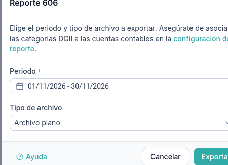

### Columnas del archivo "Documentos no incluidos" (igual en 606 y 607)

`Número de documento | Tipo de documento | Motivo`

### Reporte 606 (compras) — verificado con renglón real

**TXT (encabezado + 1 registro):**
```
606|131999999|202611|1
132000013|1|09|B0100000051||20261120||0.00|600.00|600.00|108.00|0.00|0.00|0.00|108.00|||0.00||0.00|0.00|0.00|04
```

**Columnas del Excel 606 (en orden, verificadas abriendo el .xlsx):**
Número línea · RNC/Cedula · Tipo de identificación · Tipo de bienes y servicios comprados · NCF · NCF ó documento modificado · Fecha de comprobante (AAAAMM) · Fecha de comprobante (D) · Fecha de pago (AAAAMM) · Fecha de pago (D) · Monto facturado en servicios · Monto facturado en bienes · Total monto facturado · ITBIS facturado · ITBIS retenido · ITBIS sujeto a proporcionalidad · ITBIS llevado al costo · ITBIS por adelantar · ITBIS percibido en compras · Tipo de retención en ISR · Monto retención renta · ISR percibido en compras · Impuesto selectivo al consumo · Otros impuestos/tasas · Monto propina legal · Forma de pago.

**Renglón de ejemplo (compra a crédito no pagada, ítem inventariable):**
- Tipo identificación `1` (RNC), tipo bienes/servicios `09`, NCF `B0100000051`, fecha 20261120, fecha de pago **vacía**.
- Monto en servicios `0.00` / Monto en bienes `600.00` / Total `600.00` (el ítem fue a "bienes" por el *Tipo de compra* configurado en la cuenta).
- ITBIS facturado `108.00`, ITBIS por adelantar `108.00`, retenciones y demás impuestos `0.00`/vacíos.
- **Forma de pago `04`** (compras a crédito) — derivada automáticamente del estado de pago; **no hay campo manual** de forma de pago.

**Dónde se piden los "campos extra" del 606 (tipo de bienes y servicios 01–11, forma de pago):**
- **NO se piden en la factura de compra.** El formulario de compra solo ofrece el checkbox **"Asignar NCF comprobante de compra"** (con campo "No." para el NCF manual) y el checkbox **"Operación sujeta a proporcionalidad"**. "Personalizar opciones" solo permite ocultar Almacén.
- El mapeo es **por cuenta contable**, en *Reportes → Fiscales → (enlace "configuración del reporte" del modal de exportación)* → tabla **Cuenta contable | Categoría DGII | Tipo de compra**:
  - Categoría DGII (opciones): Gastos de personal; Gastos por trabajos, suministros, y servicios; Arrendamientos; Gastos de activos fijos; Gastos de representación; Otras deducciones admitidas; Gastos financieros; Gastos extraordinarios; Compras y gastos que hacen parte del costo de venta; Adquisiciones de activos.
  - "Compras y gastos que hacen parte del costo de venta" se exporta como código **`09`**.
  - Tipo de compra: **Bienes / Servicio** (determina en qué columna cae el monto del renglón 606).

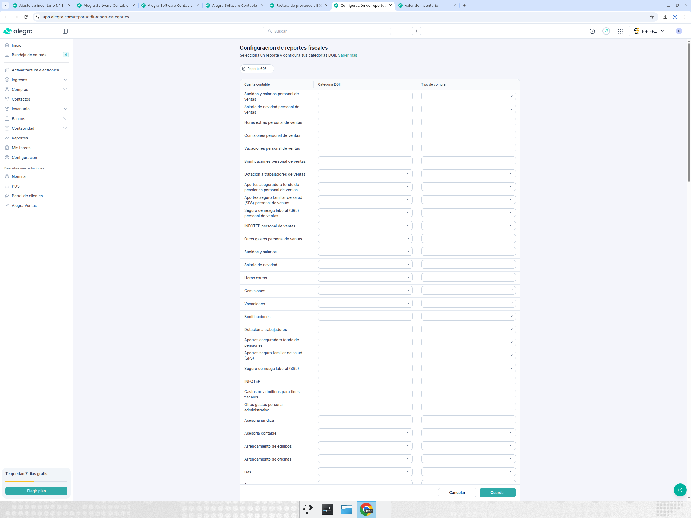

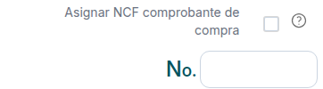

**Requisitos/exclusiones verificados del 606:**
- Empresa debe tener RNC (encabezado del TXT: `606|<RNC>|AAAAMM|<cantidad>`).
- La identificación del contacto debe tener longitud correcta (11 cédula / 9 RNC) **y pasar el dígito verificador DGII**. Motivos de exclusión vistos literalmente:
  - `La identificación del proveedor/cliente asociado no tiene la longitud requerida. La longitud permitida debe ser de 11 dígitos para cédulas y 9 para RNC.`
  - `La comprobación del dígito verificador de la identificación: 132000015 fue erronea`
- La cuenta del gasto/costo debe tener **Categoría DGII configurada**; si no, el documento se excluye con motivo:
  - `La cuenta contable <nombre> o su cuenta contable madre aún no tienen configurada la clasificación de costos y gastos.`
- Excluidos reales en la prueba: `B0100000050` (proveedor sin ID válido), `B0300000001` (nota de débito de compra, ID inválido), `B1300000001/02/03` (transacciones con cuentas sin clasificación).

### Reporte 607 (ventas) — verificado con renglones reales

**TXT final (encabezado + 3 registros):**
```
607|131999999|202611|3
402123455|1|B0100000002||1|20261120|20261120|800.00|144.00|43.20||0.00||0.00|0.00|0.00|15.80|0.00|0.00|885.00|0.00|0.00|0.00
402123455|1|B0400000003|B0100000002|1|20261120||750.00|135.00|0.00||0.00||0.00|0.00|0.00|0.00|0.00|0.00|0.00|0.00|0.00
402123455|1|B0400000002|B0100000003|1|20261120||800.00|0.00|0.00||0.00||0.00|0.00|0.00|0.00|0.00|0.00|0.00|0.00|0.00
```

**Columnas del Excel 607 (en orden, verificadas):**
Número línea · RNC/Cedula · Tipo de identificación · NCF · NCF modificado · Tipo de ingreso · Fecha de comprobante · Fecha de retención · Monto facturado · ITBIS facturado · ITBIS retenido por terceros · ITBIS percibido · Retención de renta por terceros · ISR percibido · Impuesto selectivo al consumo · Otros impuestos/tasas · Monto propina legal · Efectivo · Cheque/Transferencia/Depósito · Tarjeta Débito/Crédito · Venta a crédito · Bonos o certificados de regalo · Permuta · Otras formas de venta · Monto Facturado por Exportaciones.

**Requisitos/exclusiones del 607:**
- Sin RNC de empresa, la exportación se bloquea con mensaje "Actualiza tu identificación" (se configuró `131999999`).
- La cuenta de ingreso debe tener **Tipo de ingreso** configurado en la misma página de configuración de reportes fiscales; si no: `No se encontró configurado el tipo de ingreso para la cuenta contable.` Opciones: Ingresos por operaciones (No financieros) → código **`1`**; Ingresos financieros; Ingresos extraordinarios; Ingresos por arrendamientos; Ingresos por ventas de activos depreciables; Otros ingresos.
- Mismas validaciones de identificación del cliente (longitud + dígito verificador). `B0100000001` y `B0400000001` excluidos por cédula `132456789` inválida.
- Observación: la factura `B0200000001` (B02, "cobrada", Juan Pérez, 13/11) **no aparece ni como registro ni como excluida** en la exportación de noviembre; no se determinó el motivo con los datos visibles.

**Notas de crédito (B04) emitidas >30 días vs ≤30 días — probado con dos NC reales:**
- NC `B0400000003` (mismo día que su factura): `Monto facturado 750.00`, **ITBIS facturado 135.00** (el ITBIS sí se reporta).
- NC `B0400000002` (emitida 20/11 contra factura 15/10, **>30 días**): `Monto facturado 800.00`, **ITBIS facturado 0.00** — Alegra omite el ITBIS de la NC, coherente con la regla DGII de no acreditar ITBIS en NC emitidas >30 días después.
- En ambas NCs la columna **NCF modificado** trae la factura original y los montos se reportan **en positivo**; el Excel resumen "Total monto facturado" del período muestra `-750,00`, es decir las NCs **netean** contra las ventas en el total.
- Columnas de formas de pago en `0.00` en las NCs; **Fecha de retención vacía** en las NCs.

**Facturas anuladas → van al 608, no al 607:**
- Tras anular `B0100000004`, la re-exportación del 607 siguió en 3 registros: la factura anulada **no aparece** en el 607 ni siquiera como excluida; aparece en el 608 (ver abajo).
- Diálogo de anulación (verificado): pide **Fecha de anulación** y **Motivo de anulación** ("esta información es necesaria para generar tus reportes correctamente"), con opciones: Deterioro de factura pre-impresa; Errores de impresión (factura pre-impresa); Impresión defectuosa; Corrección de la información; Cambio de productos; Devolución de productos; Omisión de productos; Errores en secuencia de NCF; Por cese de operaciones; Pérdida o hurto de talonario(s).

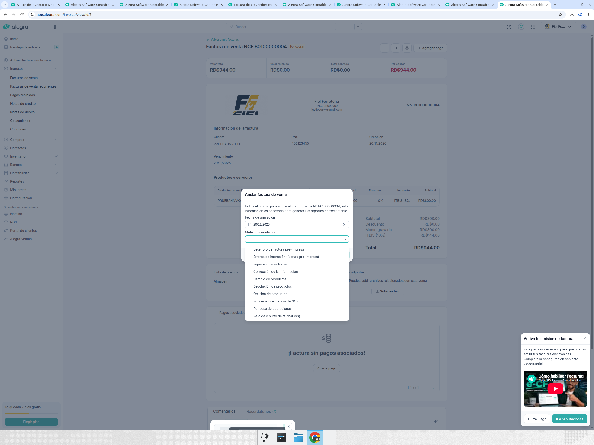

**Retenciones y pagos mixtos (factura `B0100000002`):**
- Factura 944.00 con **Retención ITBIS 30%** (43.20): el 607 reporta `ITBIS retenido por terceros = 43.20` y **Fecha de retención = 20261120**. Tipos de retención disponibles en la factura de venta (verificado): Retención ITBIS (30/75/100%), Alquileres 10/15%, Honorarios por servicios 10/15%, Otras rentas Ley 11-92 10/15%, Otras rentas Decreto 139-98 2%. La factura muestra "Total a pagar" = total − retención (900.80).
- La retención **no se suma a ninguna columna de forma de pago**: las columnas de pago reportan solo lo cobrado/pendiente por el cliente.
- Antes de cualquier pago, el total íntegro iba en `Venta a crédito = 944.00` (exportación previa verificada). Tras aplicar NC por 885.00 + pago en efectivo 15.80: `Efectivo = 15.80`, `Venta a crédito = 885.00` — **el saldo cubierto con nota de crédito sigue reportándose en la columna "Venta a crédito"** (15.80 + 885.00 = 900.80 = total − retención). El método de pago del abono se elige entre: Efectivo, Cheque, Transferencia, Depósito, Tarjeta débito, Tarjeta crédito, Venta a crédito, Permuta, Bonos o certificados de regalo, Otras formas de ventas (coincide con las columnas del 607).

### Reporte 608 (comprobantes anulados) — verificado

**TXT (encabezado + 1 registro):**
```
608|131999999|202611|1
B0100000004|20261120|7
```

**Columnas del Excel 608:** `Número línea | NCF | Fecha de comprobante | Tipo de anulación`
Encabezado del archivo: RNC o Cédula, Período, Cantidad de registros (sin "Total monto facturado").

- La anulación con motivo **"Devolución de productos"** se exportó con **Tipo de anulación `7`** (valor literal del archivo).
- El 608 no genera archivo de excluidos y su configuración no aparece en la página de categorías DGII (el selector solo ofrece 606 y 607).

## Prueba 5 — Saldos iniciales de inventario ✅ Verificado en pantalla

- En *Contabilidad → Catálogo de cuentas* existe el botón **"Saldos iniciales"**, que abre el asistente **"Migra tu información contable"** con dos caminos: "Desde archivo o plantilla" o "Registrar de forma manual" → **"Crear saldos iniciales"**.
- El formulario manual (numeración "Saldos iniciales [SB]") pide una fecha y muestra un **formulario de estado financiero con todas las cuentas** (incluida "Inventarios"), permitiendo registrar saldo por cuenta y opcionalmente asociar un contacto.
- **No existe un flujo específico a nivel de ítem/stock** para cargar el inventario inicial: es un **asiento contable general** por cuenta. La carga a nivel de ítem (cantidad × costo del producto) se hace por la ficha del producto (Prueba 1), que a su vez genera el asiento automático `II-xx` contra "Ajustes iniciales en inventario".

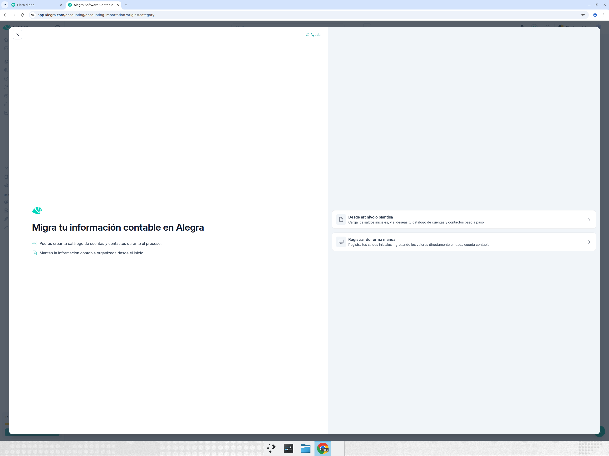

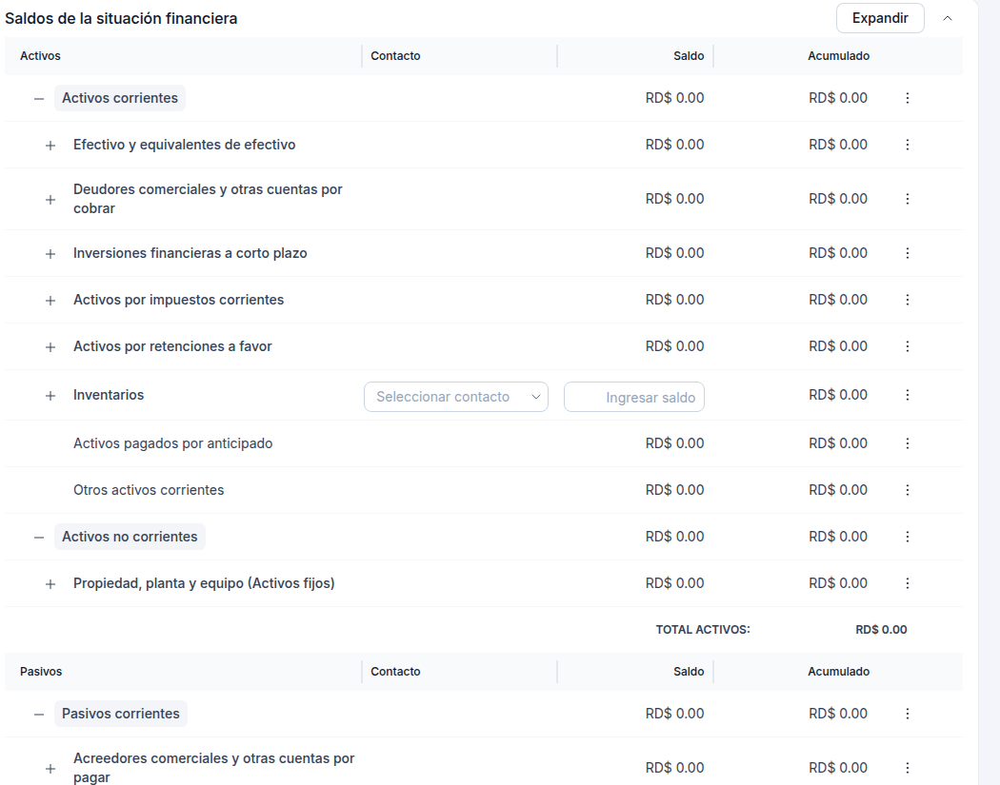

---

## Asientos contables adicionales verificados en pantalla

**Factura de proveedor `B0100000051` — asiento `FP-2`, 20/11/2026:**

| Cuenta | Cargo | Abono |
|---|---|---|
| ITBIS a favor | RD$108.00 | |
| Inventarios | RD$600.00 | |
| Cuentas por pagar a proveedores nacionales | | RD$708.00 |

**Nota de crédito `B0400000002` — asiento `NC-B0400000002`, 20/11/2026:**

| Cuenta | Cargo | Abono |
|---|---|---|
| ITBIS por pagar (ITBIS 18%, base RD$800) | RD$144.00 | |
| Devoluciones en ventas | RD$800.00 | |
| Inventarios | RD$596.15 | |
| Cuentas por cobrar clientes | | RD$944.00 |
| Costos del inventario | | RD$596.15 |
| **Total** | **RD$1,540.15** | **RD$1,540.15** |

(La mercancía devuelta reingresa a inventario al **costo promedio vigente al momento de la NC**, 596.15, no al costo original de la venta.)

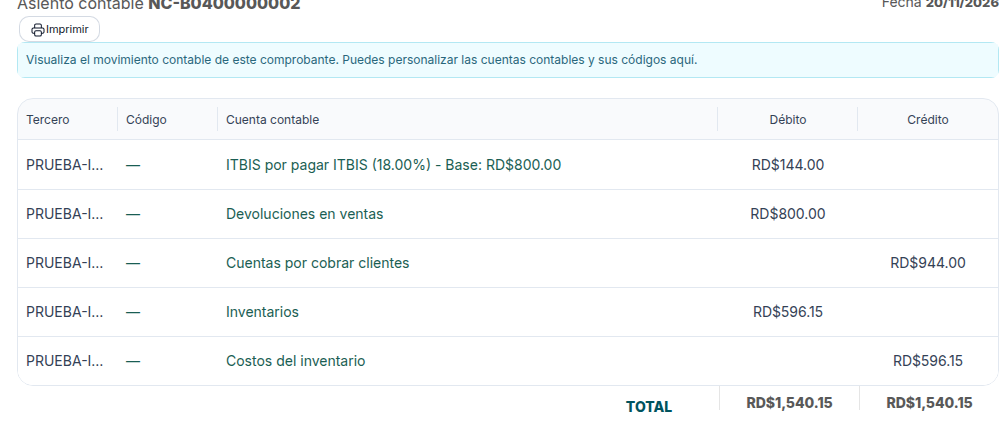

## Cosas no encontradas / no probadas

- **Vista en pantalla de los reportes 606/607/608:** no existe; solo modal de exportación (periodo + tipo de archivo). *Verificado.*
- **Campo de "tipo de bienes y servicios" o "forma de pago" en la factura de compra:** no existe; el mapeo es por cuenta en la configuración del reporte y la forma de pago se deriva del estado de pago. *Verificado.*
- **Pestaña "Saldos iniciales" a nivel de ítems de inventario:** no existe; solo asiento general por cuenta. *Verificado.*
- Anulación de **nota de crédito** o de factura de compra hacia el 608: *no probado* (solo se anuló una factura de venta).
- Factura con pago por **tarjeta/cheque** para poblar esas columnas del 607: *no probado* (solo efectivo + crédito + retención + NC).
- Motivo de no inclusión de `B0200000001` (B02) en el 607: *no determinado*; no aparece ni como registro ni como excluida.

## Estado final de los datos de prueba

- Producto `PRUEBA-INV-01`: Cant. inicial 15, **Cant. actual 14** (verificado en la ficha del ítem), costo por unidad RD$600; el costo promedio observado en las operaciones fue RD$625 (tras la entrada) y RD$596.15 (tras eliminar el ajuste de entrada; las devoluciones por NC reingresaron a ese promedio).
- Documentos vigentes: facturas `B0100000002` (cobrada), `B0100000003` (cobrada por crédito), compra `B0100000051`, NCs `B0400000002/03`; anulada `B0100000004`; ajuste salida N° 2 (el ajuste de entrada N° 1 fue eliminado).

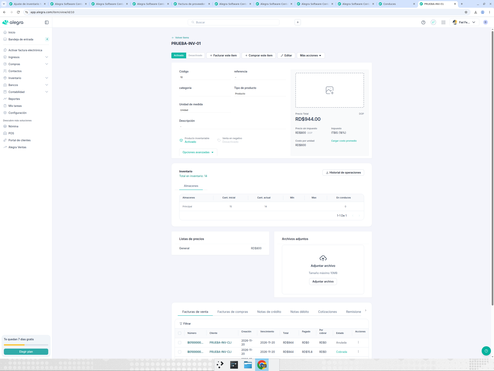
