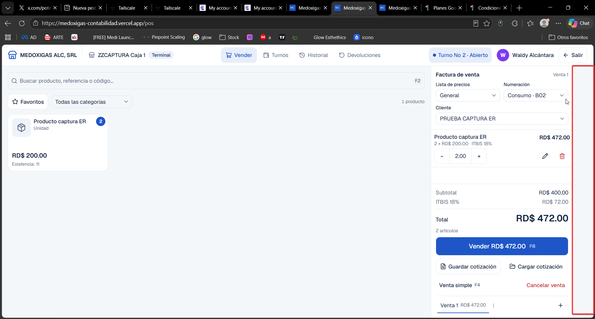
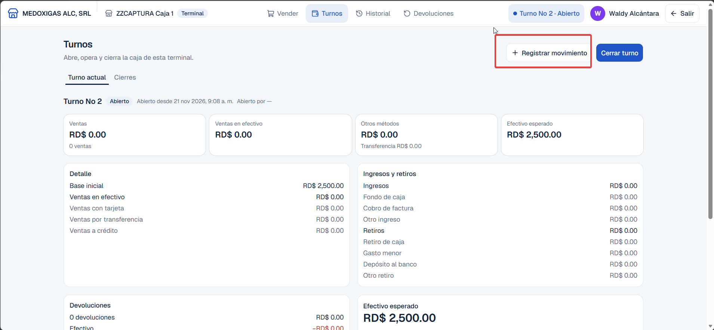
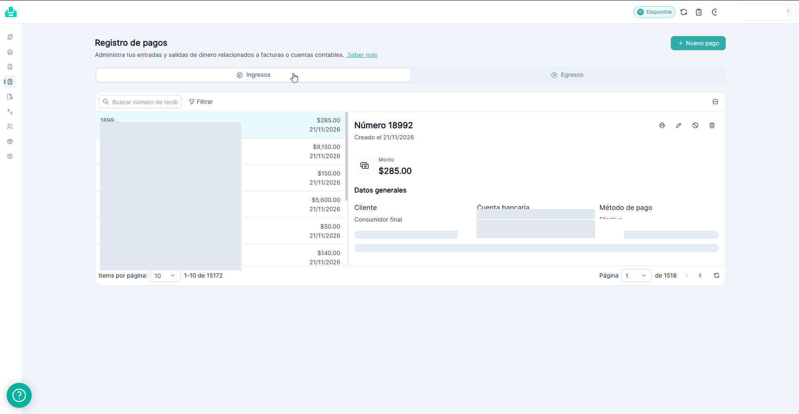
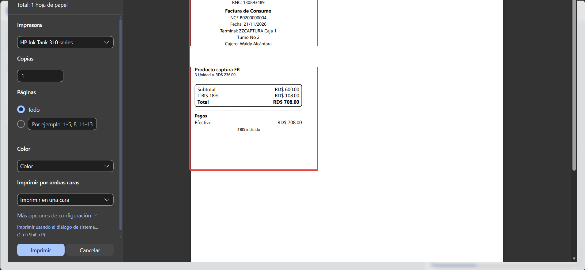
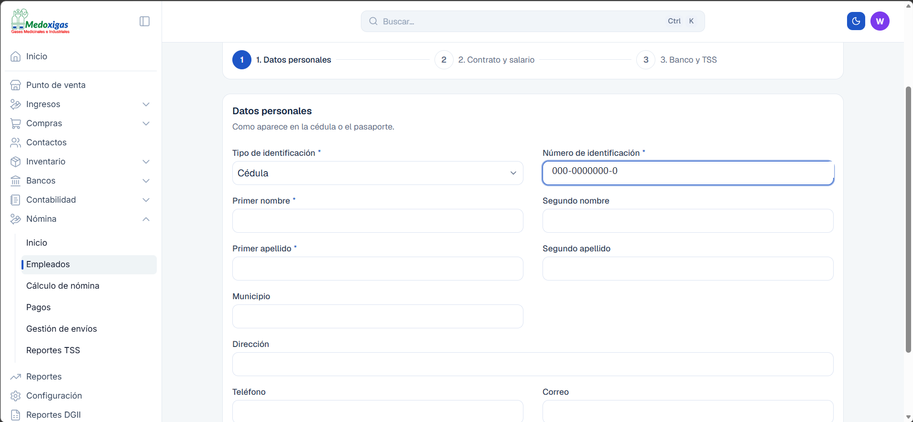

# Rediseño UI/UX estilo Alegra — plan maestro

**Estado:** plan vivo. **No se ha cambiado código.** Este documento y sus capturas son la única entrega.
**Versión:** v2 — copia total del diseño de Alegra; C7 limitado al ticket térmico 80/57 mm.
**Fecha:** 21 nov 2026.
**Fuente:** mensajes y capturas de Waldy en el hilo de T3 Code (`img/`).
**Alcance:** POS completo (menú, catálogo, carrito, ticket térmico 80/57 mm, turnos, historial, devoluciones y Registro de pagos), menú lateral del dashboard y el bug de la cédula en Nómina → Empleados.
**Uso:** cada `C#` es un brief autocontenido para un subagente. No ejecutar todo en un solo PR.

## Resumen en 30 segundos

- **POS completo:** se copia el diseño del POS de Alegra en todo: menú lateral, catálogo de productos, carrito, pestañas, checkout (segunda pasada) y ticket térmico. Se elimina la barra de tabs superior y el panel del carrito se pega al borde derecho.
- **Registrar movimiento:** sale de Turnos y se convierte en una pantalla propia, **Registro de pagos**, con Ingresos/Egresos, buscador, lista paginada y detalle, como Alegra.
- **Ticket térmico 80 mm y 57 mm:** mismo orden y jerarquía que el ticket de Alegra, con el **logo de Medoxigas** arriba. **No es el PDF Carta de la factura.**
- **Nómina:** se corrige el campo cédula (máscara + validación del dígito verificador en el cliente).
- **Dashboard:** el sidebar se alinea con las medidas de `GUIA-MENU.md` (271 px, ítems de 32 px, barra activa de 3 px, iconos de 20 px).
- **Nada de esto está implementado todavía:** este archivo es el plan.

## Lo que necesito de Waldy antes de codear

1. Decidir el alcance de Registro de pagos: solo recibos del POS o también pagos de Contabilidad (C6).
2. Decir qué pasa exactamente con la cédula: ¿no deja escribir, se borra, marca error, no avanza? (C8).
3. Confirmar si la copia total incluye el **teal de Alegra** o mantenemos el **azul Medoxigas**. Recomendación: mantener el azul por la regla del repo; el resto del diseño se copia igual.

Las demás dudas están en §6 y no bloquean el arranque.

---

## 0. Cómo usar este plan

1. Leer `AGENTS.md`, `docs/plantilla-diseno.md` y la guía de Alegra que corresponda al cambio.
2. Confirmar con Waldy las dudas de §6 que bloqueen el cambio. No inventar la respuesta.
3. Cada `C#` se ejecuta en su propio worktree, con los archivos listados en «Archivos que posee». Si dos cambios comparten un archivo, van en el mismo worktree o en serie.
4. Antes de decir «listo»: `pnpm typecheck`, `pnpm check`, `pnpm test` y `pnpm build`; capturas claro/oscuro/móvil si tocó UI.
5. Un PR = una tarea; diff < 400 líneas fuera de generados/lockfile.
6. Si el cambio contradice `docs/dominio-pos.md` o `AGENTS.md`, se actualiza el documento en el mismo PR (o en un PR de docs inmediatamente antes).

### Reglas de diseño que aplican a todo

- **Copia total del diseño:** se replican layout, medidas, proporciones, componentes, estados y jerarquía visual de Alegra en las pantallas de este plan. Waldy lo confirmó: «Vamos a copiar totalmente el diseño de Alegra». Lo que **no** se copia: código/HTML/CSS, textos literales, logos ni assets. El código es propio y los datos son de Medoxigas.
- **Colores:** solo tokens de Medoxigas (`--primary` azul `#1e56c7`, fondos, bordes del tema). **Nunca** el teal `#00b19d` de Alegra ni hex sueltos, salvo que Waldy apruebe explícitamente cambiar el token de marca.
- **Tipografía:** Inter, base 14 px; títulos y montos con el peso de la plantilla.
- **Radios:** 6 px en ítems de menú, 8 px en botones/tarjetas, 10–12 px en inputs y diálogos.
- **Nada de `<select>` nativo** ni `<input type="date">`: usar `Select`/`SelectCampo`, `Combobox` y `DatePicker`.
- **Tablas:** `TablaLista`; encabezados de 48 px (`h-12`).
- **Dinero:** `numeric(14,2)` en base y cálculos en el servidor; nunca float para montos guardados.
- **`src/components/ui/` se usa tal cual**, salvo aprobación explícita de Waldy para tocar un primitivo.
- **Dark mode y móvil** son parte del terminado, no un extra.
- **Capturas obligatorias:** el subagente que implementa entrega PNG del resultado (claro, oscuro y móvil si aplica). Sin captura, no está listo.
- **Privacidad:** las capturas de este plan con datos reales están censuradas (barras grises). No commitear originales con nombres de clientes, cuentas o cédulas.

---

## 1. Resumen de cambios

| ID | Cambio | Tipo | Pantalla / ruta | Evidencia | Prioridad |
|---|---|---|---|---|---|
| **C1** | El panel «Factura de venta» no pega al borde derecho | Bug de layout | `/pos` | `img/01-pos-actual-borde-derecho.png` | **P0** |
| **C2** | Menú lateral del dashboard con el diseño de Alegra | Rediseño | Todo `/dashboard` | `img/03-alegra-pos-menu.png` + `21-guia-menu-*.png` | P1 |
| **C3** | Menú lateral del POS; se elimina la barra superior de navegación | Rediseño | `/pos` | `img/01`, `img/03` | **P0** |
| **C4** | Panel del carrito (Factura de venta) igual a Alegra | Rediseño | `/pos` | `img/02-alegra-pos-carrito.png` | **P0** |
| **C5** | Catálogo de productos con el diseño de Alegra | Rediseño | `/pos` | `img/02` | **P0** |
| **C6** | «Registrar movimiento» sale de Turnos y nace «Registro de pagos» | Mover pantalla | `/pos/turnos` → `/pos/pagos` | `img/04`, `img/05` | P1 |
| **C7** | Ticket térmico 80 mm y 57 mm con el diseño de Alegra + logo | Rediseño de impresión | Impresión POS (ticket) | `img/06` + `22-ticket-imprimir.png` | P1 |
| **C8** | La cédula en Nómina → Empleados no funciona | Bug | `/dashboard/contabilidad/nomina/empleados/nuevo` | `img/07-nomina-cedula.png` | **P0** |

---

## 2. Capturas de este plan

> Las capturas 05, 06 y 07 tienen datos personales censurados. El original no se versiona.

| Archivo | Qué muestra | Para qué sirve |
|---|---|---|
| `img/01-pos-actual-borde-derecho.png` | Nuestro `/pos`. El recuadro rojo marca la franja muerta a la derecha del panel. | C1: reproducir el bug y verificar el fix. |
| `img/02-alegra-pos-carrito.png` | Alegra POS. El recuadro rojo rodea el panel «Factura de venta». | C4: referencia del carrito. |
| `img/03-alegra-pos-menu.png` | Alegra POS. El recuadro rojo rodea el menú lateral. | C2/C3: referencia del menú. |
| `img/04-turnos-actual-boton.png` | Nuestro `/pos/turnos`. El recuadro rojo marca «Registrar movimiento». | C6: sacar ese botón de Turnos. |
| `img/05-alegra-registro-pagos.png` | Alegra → Registro de pagos. Tabs Ingresos/Egresos, buscador, «Nuevo pago», lista + detalle. | C6: estructura de la pantalla nueva. |
| `img/06-ticket-actual.png` | Nuestro ticket 80 mm en la vista de impresión. | C7: hoy no tiene logo y el orden es propio. |
| `img/07-nomina-cedula.png` | Nuestro formulario de empleado, campo cédula. | C8: bug reportado. |

### Referencias que ya existen en el repo

| Referencia | Ruta |
|---|---|
| Guía medida del menú de Alegra | [`docs/alegra/css-menu/GUIA-MENU.md`](../../alegra/css-menu/GUIA-MENU.md) |
| Guía del POS de Alegra | [`docs/alegra/pos/design-alegra-pos.md`](../../alegra/pos/design-alegra-pos.md) |
| Flujo del POS de Alegra | [`docs/alegra/pos/alegra-pos.md`](../../alegra/pos/alegra-pos.md) |
| Menú lateral de Alegra POS | [`docs/alegra/pos/capturas/22-menu-lateral.png`](../../alegra/pos/capturas/22-menu-lateral.png) |
| Registro de pagos de Alegra | [`docs/alegra/pos/capturas/22-registro-pagos.png`](../../alegra/pos/capturas/22-registro-pagos.png) |
| Ticket de Alegra (80/57 mm) | [`docs/alegra/pos/capturas/22-ticket-imprimir.png`](../../alegra/pos/capturas/22-ticket-imprimir.png) |
| Contrato del POS | [`docs/dominio-pos.md`](../../dominio-pos.md) |
| Plantilla de diseño | [`docs/plantilla-diseno.md`](../../plantilla-diseno.md) |

> El **PDF Carta** de la factura (`05-factura-B01.pdf`, `05-factura-B02.pdf`) existe en `docs/alegra/capturas/`, pero **no es el objetivo de C7**. C7 es el ticket térmico de 80/57 mm del POS.

---

## 3. Cambios, uno por uno

### C1 — El panel «Factura de venta» no pega al borde derecho

**Prioridad:** P0 (bug visual que Waldy marcó primero).
**Pantalla:** `/pos` en escritorio.

**Lo que pidió Waldy:** «Eso tiene como un error de UI que no se pega a la derecha.»

**Evidencia:**



**Qué se ve:** el panel blanco «Factura de venta» termina antes del borde derecho de la ventana. Queda una franja vertical del fondo de la página entre el panel y el borde. A la izquierda del panel sí hay borde; a la derecha no hay nada que cierre la composición.

**Estado actual (archivos):**

- `src/app/(pos)/pos/layout.tsx:41-61`: shell `min-h-dvh` con header arriba y `<main>` debajo. No fija el alto al viewport ni bloquea el scroll de la página.
- `src/app/(pos)/pos/_components/vender/vender-pos.tsx:432-520`: dos columnas (`flex`), catálogo con `p-3 sm:p-4`, panel en un wrapper `w-[400px] shrink-0`.
- `src/app/(pos)/pos/_components/vender/panel-factura.tsx:104-110`: `<aside>` `h-full` con `border-l`; no tiene borde derecho ni fondo de cierre.
- `src/app/(pos)/pos/_components/vender/catalogo-pos.tsx:133`: el catálogo ya tiene su propio `overflow-y-auto`.

**Causa probable:** el panel vive dentro de un contenedor que scrollea con la página; el alto del shell no está amarrado al viewport. En la captura, a 1920 px, el panel de 400 px termina en ~1848 px: hay ~72 px de franja. Puede ser el scroll vertical del documento, un gutter de scrollbar o un ancho externo; el código del POS no tiene un `max-w`, así que primero hay que reproducirlo y medir, no asumir.

**Objetivo:**

- El shell del POS mide exactamente el viewport en escritorio (`h-dvh` / `min-h-dvh` + `overflow-hidden` donde corresponda).
- El panel es la última columna y su borde derecho coincide con el borde derecho de la ventana.
- Solo scrollean el catálogo y la lista del carrito; el documento no scrollea en `/pos` escritorio.
- En móvil se mantiene el `Sheet` actual.

**Criterios de aceptación (medibles):**

1. A 1024, 1280, 1440 y 1920 px, `panel.getBoundingClientRect().right` es igual a `window.innerWidth` (tolerancia 1 px).
2. `document.documentElement.scrollHeight === document.documentElement.clientHeight` en `/pos` escritorio; no hay scroll vertical de página.
3. No aparece scroll horizontal en ningún viewport.
4. El catálogo sigue scrolleando dentro de su columna y el carrito mantiene su scroll interno.
5. Capturas claro/oscuro a 1440 y 1920, con la medida del borde visible (DevTools o regla).

**Archivos que posee:**

- `src/app/(pos)/pos/layout.tsx`
- `src/app/(pos)/pos/_components/vender/vender-pos.tsx`
- `src/app/(pos)/pos/_components/vender/panel-factura.tsx`
- `src/app/(pos)/pos/_components/vender/catalogo-pos.tsx` (solo si hay que ajustar el contenedor de scroll)

**No tocar / fuera de alcance:** el diseño interno del carrito (eso es C4), la lógica del carrito y el checkout.

**Dudas:** ninguna para el fix; la captura es suficiente.

---

### C2 — Menú lateral del dashboard con el diseño de Alegra

**Prioridad:** P1.
**Pantalla:** todo `/dashboard` (menú global).

**Lo que pidió Waldy:** «El menú yo lo quería igual que Alegre… no quiero un menú que esté arriba, quiero un menú que esté al lado también. No quiero una cosa que esté arriba ni nada, quiero también al lado y quiero que se parezca a Alegre.»

**Evidencia:** `img/03-alegra-pos-menu.png` (menú de Alegra POS) y las capturas medidas `docs/alegra/capturas/21-guia-menu-general.png`, `21-guia-menu-item-activo-zoom.png`, `21-guia-menu-submenu-abierto.png`, `21-guia-menu-colapsado.png`, `21-guia-menu-movil.png`.

**Estado actual:**

- `src/app/(main)/dashboard/layout.tsx:26-34`: `SidebarProvider` con `--sidebar-width: 271px` (ya coincide con Alegra).
- `src/app/(main)/dashboard/_components/sidebar/app-sidebar.tsx:32-50`: header de **70 px**, logo de 64 px de alto, trigger de 40 px.
- `src/app/(main)/dashboard/_components/sidebar/nav-main.tsx`: ítems y submenús shadcn; el activo usa fondo de acento, sin barra lateral.
- `src/components/ui/sidebar.tsx`: primitivo shadcn; **no se edita** sin aprobación de Waldy.
- La guía `GUIA-MENU.md` §12 ya documenta la comparación: ancho 271 px (ok), colapsado 53 px vs 48 px, ítems 32 px (ok), activo sin barra, iconos 16 px vs 20 px, botón «+» al hover inexistente.

**Objetivo:** llevar el sidebar del dashboard a las medidas de `GUIA-MENU.md`:

- **Marco:** 271 px expandido; 53 px colapsado; en escritorio el colapsado es un riel que se expande al hover (si se puede hacer sin editar el primitivo; si no, dejar `collapsible=icon` y documentar la diferencia).
- **Cabecera:** 56 px de alto; logo de máximo 150 px de ancho (40 px de alto); botón de colapsar de 40×40 px, radio 8 px.
- **Zona de scroll:** padding 8 px, separación 8 px entre grupos.
- **Ítems:** 32 px de alto, radio 6 px, padding `6px 8px`, icono 20×20 px gris, texto 14/21 px.
- **Activo:** fondo `slate-200/45` + **barra primaria de 3×16 px** a la izquierda; icono y texto en color fuerte. Hover/pulsado con las opacidades de la guía.
- **Acordeón:** `margin-left: 17px`, `padding-left: 10px`, borde izquierdo de 1 px; subítems de 32 px con el mismo activo.
- **Título de grupo:** 12 px/500 gris.
- **Móvil:** cajón de 271 px + velo slate-700 al 60 %.
- **Pie:** usuario/versión/soporte (no el banner de prueba de Alegra).

**Criterios de aceptación:**

1. Playwright a 1280×800 mide: sidebar 271 px, cabecera 56 px, ítem 32 px, icono 20 px, barra activa 3×16 px.
2. El ítem activo se ve igual en todos los módulos y subítems.
3. El colapsado y el hover no rompen el contenido ni el foco de teclado.
4. Móvil: drawer de 271 px + velo; se cierra al navegar.
5. Capturas claro/oscuro/móvil.
6. No cambian rutas, roles ni etiquetas existentes.

**Archivos que posee:**

- `src/app/(main)/dashboard/_components/sidebar/app-sidebar.tsx`
- `src/app/(main)/dashboard/_components/sidebar/nav-main.tsx`
- `src/app/(main)/dashboard/layout.tsx`
- `src/components/ui/sidebar.tsx` **solo con aprobación explícita** (para el riel de 53 px con hover)

**No tocar / fuera de alcance:** el menú del POS (eso es C3); el topbar de búsqueda/usuario (se conserva).

**Dudas:** ninguna de alcance: Waldy confirmó copiar el diseño completo. C2 aplica al dashboard y C3 al POS, con el mismo lenguaje visual.

---

### C3 — Menú lateral del POS; se elimina la barra superior de navegación

**Prioridad:** P0 (es el cambio estructural del POS).
**Pantalla:** `/pos`, `/pos/turnos`, `/pos/historial`, `/pos/devoluciones` y la nueva `/pos/pagos`.

**Lo que pidió Waldy:** «No quiero un menú que esté arriba, quiero un menú que esté al lado también… el mismo que Alegra, este mismo diseño.»

**Evidencia:** `img/03-alegra-pos-menu.png` (recuadro rojo sobre el menú) y `img/01-pos-actual-borde-derecho.png` (nuestra barra superior actual). Referencia adicional: `docs/alegra/pos/capturas/22-menu-lateral.png`.

**Estado actual:**

- `src/app/(pos)/pos/layout.tsx:41-61`: header `EncabezadoPos` arriba y `<main>` debajo.
- `src/app/(pos)/pos/_components/encabezado-pos.tsx:24-52`: barra de 56 px con logo, selector de terminal, `NavegacionPos` (Vender, Turnos, Historial, Devoluciones), estado del turno, usuario y «Salir».
- `src/app/(pos)/pos/_components/navegacion-pos.tsx:17-22`: los cuatro destinos en tabs horizontales; en móvil, dropdown.
- No hay sidebar en `(pos)/pos/layout.tsx`.

**Objetivo:**

- **Quitar la barra superior de navegación.** La información de empresa, terminal, turno y usuario pasa al menú lateral.
- **Riel izquierdo de ~56 px** con iconos, que al hover/foco expande un panel de **271 px** con etiquetas (como Alegra). Un botón de pin permite dejarlo abierto.
- **Contenido del menú (misma estructura que Alegra):**
  - Facturar → `/pos` (activo).
  - **Ingresos** (acordeón):
    - Historial de ventas → `/pos/historial`.
    - Registro de pagos → `/pos/pagos` (nuevo; C6).
  - **Turnos** (acordeón):
    - Historial de turnos → `/pos/turnos`.
  - Devoluciones → `/pos/devoluciones`.
  - Separador.
  - Contactos → `/dashboard/contactos` (enlace a Contabilidad, pestaña nueva).
  - Inventario → `/dashboard/productos` (enlace a Contabilidad, pestaña nueva).
  - Configuraciones → `/dashboard/configuracion/pos` (enlace a Contabilidad, pestaña nueva).
  - Pie: selector de terminal, badge de turno (ABIERTO/CERRADO), usuario, «Volver a Contabilidad» y «Salir».
- **Activo:** fondo de acento + barra primaria de 3×16 px a la izquierda.
- **Móvil (<1024 px):** cajón de 271 px + velo, botón de menú en una barra mínima o flotante; no volver a tabs arriba.
- **El panel del carrito** sigue a la derecha, pegado al borde (C1) y con el diseño de C4.

**Criterios de aceptación:**

1. En `/pos` no existe la barra de tabs superior; la navegación vive en el riel.
2. Riel 56 px / panel 271 px; el panel se expande con hover o pin y no tapa el carrito de forma permanente.
3. El ítem activo coincide con la ruta actual y tiene la barra primaria.
4. Todos los destinos actuales y el nuevo Registro de pagos siguen accesibles; los enlaces a Contabilidad abren en pestaña nueva.
5. La estructura es la de Alegra: «Ingresos → Historial de ventas / Registro de pagos» y «Turnos → Historial de turnos».
6. `lector` no ve acciones de escritura; `admin`/`contador` sí.
7. Móvil: cajón + velo; el carrito sigue disponible como `Sheet`.
8. Capturas claro/oscuro a 1280/1440 y móvil.

**Archivos que posee:**

- `src/app/(pos)/pos/layout.tsx`
- `src/app/(pos)/pos/_components/encabezado-pos.tsx` (se reemplaza o se elimina)
- `src/app/(pos)/pos/_components/navegacion-pos.tsx` (se convierte en la fuente del menú o se reemplaza por `menu-pos.tsx`)
- `src/app/(pos)/pos/_components/selector-terminal.tsx`
- `src/app/(pos)/pos/_components/estado-turno-pos.tsx`
- `src/app/(pos)/pos/_components/usuario-pos.tsx`
- `src/app/(pos)/pos/_components/salir-pos.tsx`
- `src/app/(pos)/pos/_components/vender/vender-pos.tsx` (solo el layout de columnas)

**No tocar / fuera de alcance:** el catálogo se rediseña en C5, no aquí; el diseño interno del carrito se hace en C4; la lógica de turnos/caja en C6.

**Dudas:** ninguna: se copia la estructura anidada de Alegra (Ingresos → Historial de ventas / Registro de pagos; Turnos → Historial de turnos). No se muestran ítems de Alegra que no tengamos implementados (p. ej. Reportes de turnos).

**Nota de contrato:** `docs/dominio-pos.md:63` describe un «encabezado mínimo» y §1.2 lista solo cuatro pantallas. Al implementar C3/C6 hay que actualizar ese contrato y la lista de módulos de `AGENTS.md`.

---

### C4 — Panel del carrito (Factura de venta) igual a Alegra

**Prioridad:** P0.
**Pantalla:** `/pos`, columna derecha.

**Lo que pidió Waldy:** «El apartado del carrito yo creo que sea igual que Alegre.»

**Evidencia:** `img/02-alegra-pos-carrito.png` (recuadro rojo sobre el panel). Referencias: `docs/alegra/pos/capturas/22-carrito-2-productos.png`, `22-venta-tabs.png`, `22-checkout-efectivo-cambio.png`.

**Estado actual:** `src/app/(pos)/pos/_components/vender/panel-factura.tsx` ya tiene casi toda la funcionalidad:

- Header «Factura de venta» + nombre de la venta.
- Selects de lista de precios y numeración (40 px).
- Cliente (`SelectorContacto`) y vendedor opcional.
- Líneas con stepper, edición y papelera (`linea-carrito-pos.tsx`).
- Subtotal, ITBIS por tasa, total, «Vender RD$ X» (F8), guardar/cargar cotización, venta simple, cancelar.
- Pestañas de venta (`pestanas-venta-pos.tsx`).

**Objetivo visual (estructura de Alegra, tokens Medoxigas):**

- **Encabezado:** «Factura de venta» 16 px semibold; iconos de acción solo si la acción existe (no iconos decorativos).
- **Selects:** lista de precios y numeración lado a lado, etiqueta arriba, 40 px de alto.
- **Cliente:** selector ancho + botón «Nuevo» en primario suave; si no hay creación rápida, el botón abre `/dashboard/contactos/nuevo` en pestaña nueva (no un botón muerto).
- **Línea:** nombre + precio unitario pequeño; stepper `− N +`; total a la derecha; editar/eliminar con nuestros iconos. Mantener la línea expandible actual.
- **Totales:** subtotal e ITBIS en gris; total grande; el total va **dentro** del botón primario «Vender RD$ X» a todo lo ancho, con F8 a la derecha; debajo «N artículos» y «Cancelar venta» en rojo.
- **Acciones secundarias:** «Guardar cotización», «Cargar cotización» y «Venta simple» en una fila secundaria o menú «Más», para que no compitan con «Vender».
- **Pestañas:** al pie, estilo pestañas de navegador, activa con borde inferior primario.
- **Marco:** fondo `bg-card`, borde izquierdo, sin esquinas redondeadas exteriores, **pegado al borde derecho** (C1).
- **Ancho:** 400 px en escritorio (hoy 400/420); mantener el `Sheet` de 420 px en móvil.

**Criterios de aceptación:**

1. A 1280 px, el panel se ve en la misma jerarquía que Alegra: selects, cliente, líneas, totales, botón con total, pestañas.
2. El botón «Vender» contiene el total y es el único primario del panel.
3. No hay desbordes horizontales ni verticales a 1024/1280/1440.
4. Toda la funcionalidad actual sigue: lista, numeración, cliente, vendedor, ITBIS por línea, cotización, venta simple, multi-venta, atajos F4/F8.
5. Móvil: el `Sheet` conserva la misma jerarquía y el botón de cobro.
6. Capturas lado a lado con `img/02` y claro/oscuro.

**Archivos que posee:**

- `src/app/(pos)/pos/_components/vender/panel-factura.tsx`
- `src/app/(pos)/pos/_components/vender/linea-carrito-pos.tsx`
- `src/app/(pos)/pos/_components/vender/pestanas-venta-pos.tsx`
- `src/app/(pos)/pos/_components/vender/vender-pos.tsx` (solo ancho/columnas)
- `src/components/contactos/selector-contacto.tsx` **solo si** se agrega «Nuevo» y no hay una solución existente

**No tocar / fuera de alcance:** el catálogo se rediseña en C5, no en esta tarea. El checkout se revisa en una **segunda pasada** del mismo rediseño: no se declara el POS terminado hasta que el checkout (modal de pago, métodos, confirmación) hable el mismo lenguaje visual.

**Dudas:** ¿«Nuevo cliente» debe crear en el momento (modal) o abrir la ficha de Contactos en pestaña nueva? Recomendación: si ya existe creación rápida, usarla; si no, enlace.

---

### C5 — Catálogo de productos con el diseño de Alegra

**Prioridad:** P0.
**Pantalla:** `/pos`, columna izquierda.

**Lo que pidió Waldy:** «Vamos a copiar totalmente el diseño de Alegra.»

**Evidencia:** `img/02-alegra-pos-carrito.png`. Referencias: `docs/alegra/pos/capturas/22-carrito-2-productos.png`, `22-venta-item-agregado.png`, `22-factura-cerrado.png`.

**Estado actual:** `catalogo-pos.tsx` usa un buscador, chips «Favoritos» / «Todas las categorías» y tarjetas propias con imagen/icono, stock, nombre, precio y badge de cantidad. Funciona, pero no tiene la geometría de Alegra.

**Objetivo (copiar el diseño):**

- **Fila superior:** buscador ancho con lupa, icono de escáner y botón «Nuevo producto». Si la ruta de creación existe, abre el formulario; si no, enlace a `/dashboard/productos/nuevo` en pestaña nueva (no un botón muerto).
- **Grid de tarjetas cuadradas de ~140 px**, blancas, borde fino, radio 8–10 px:
  - Imagen o icono centrado.
  - `Inv. N` en primario (azul), pequeño.
  - Nombre en hasta 2 líneas.
  - Precio en semibold.
  - Estrella de favorito arriba a la derecha.
  - Badge circular con la cantidad cuando el producto está en el carrito.
  - Borde primario en la tarjeta seleccionada/agregada.
  - Badge «Agotado» con icono de advertencia cuando no hay stock.
- **Tarjeta «Venta simple» (F4)** al inicio del grid, como Alegra, si se conserva la función (hoy existe).
- **Interacción:** clic agrega 1 unidad, actualiza el badge y el carrito; hover/foco como Alegra.
- **Funciones nuestras que se conservan:** favoritos, filtro por categoría, búsqueda por nombre/referencia/código, stock e imágenes. Si el diseño de Alegra no tiene espacio para un control, se mueve a un lugar discreto (p. ej. filtro de categoría como `Select` en la fila superior); no se elimina la función.
- **Marca:** tokens de Medoxigas (azul en lugar de teal), datos y textos propios. No se copian el logo ni los textos de Alegra.

**Criterios de aceptación:**

1. Grid de tarjetas de ~140 px; 5 columnas a 1920 y 4 a 1280 (ajustar con la medida real de la guía).
2. Tarjeta con imagen/icono, `Inv. N`, nombre, precio, estrella, badge de cantidad y borde activo.
3. Fila superior con buscador, escáner y «Nuevo producto».
4. Clic agrega al carrito y actualiza el badge; sin regresiones de búsqueda, favoritos, categorías ni stock.
5. Capturas claro/oscuro/móvil y comparación lado a lado con `img/02`.

**Archivos que posee:**

- `src/app/(pos)/pos/_components/vender/catalogo-pos.tsx`
- `src/app/(pos)/pos/_components/vender/tarjeta-producto-pos.tsx`
- `src/app/(pos)/pos/_components/vender/buscador-catalogo-pos.tsx`
- `src/app/(pos)/pos/_components/vender/vender-pos.tsx` (solo layout del grid)
- `src/lib/pos/tipos.ts` solo si hace falta un campo para la tarjeta

**No tocar / fuera de alcance:** la lógica del carrito, el checkout y la impresión.

**Dudas:** ¿se conserva la tarjeta «Venta simple» al inicio del grid? Recomendación: sí, es parte de Alegra y la función ya existe. ¿«Nuevo producto» abre el formulario de Contabilidad en pestaña nueva? Recomendación: sí.

---

### C6 — «Registrar movimiento» sale de Turnos y nace «Registro de pagos»

**Prioridad:** P1.
**Pantallas:** `/pos/turnos` (quitar botón) y `/pos/pagos` (nueva).

**Lo que pidió Waldy:** «La función de registrar movimiento principalmente yo no la quiero en turnos, quiero otra opción que la tiene igual que Alegra.» Y después: «Que también tenga el registro de pagos de Alegre… igualito que Alegre, lo mismo.»

**Evidencia:**





> La captura 05 tiene nombres y cuentas censurados con barras grises. La estructura (tabs, buscador, «Nuevo pago», lista, detalle, paginación) es lo que se copia.

**Estado actual:**

- `src/app/(pos)/pos/_components/turnos/turnos-pos.tsx:199-209`: botón «Registrar movimiento» en el encabezado de Turnos.
- `src/app/(pos)/pos/_components/turnos/dialogo-movimiento.tsx`: modal completo (ingreso/retiro, cobro de factura, gasto menor, depósito, otro).
- `src/lib/pos/acciones.ts:192`: `registrarMovimientoTurno`.
- `src/lib/pos/consultas.ts`: `getResumenTurno` trae los movimientos del turno; `tabla-movimientos-turno.tsx` los muestra.
- No existe una pantalla de registro histórico paginado de movimientos.

**Objetivo:**

1. **Quitar el botón de Turnos.** Turnos queda con «Cerrar turno», resumen, cierres e impresión. No se duplica el acceso.
2. **Nueva pantalla `/pos/pagos` — «Registro de pagos»:**
   - Encabezado: título, subtítulo propio (no copiar el texto de Alegra) y botón primario «Nuevo pago».
   - Tabs **Ingresos / Egresos** como pills en una franja gris.
   - Buscador por número de recibo + «Filtrar».
   - Lista maestro-detalle: a la izquierda, recibo, cliente/proveedor, monto y fecha; a la derecha, detalle del recibo.
   - Detalle: número, fecha de creación, monto grande, cliente, cuenta bancaria, método de pago, cuenta contable y notas.
   - Acciones del detalle: **Imprimir** y **Ver factura/gasto** si existen. **No** mostrar editar/eliminar: `pos_turno_movimientos` es inmutable en nuestro backend. Esto es una diferencia deliberada con Alegra.
   - Paginación al pie (10/25/50; «Página X de Y»), como el resto de listas.
3. **«Nuevo pago» reutiliza `DialogoMovimiento`** (no duplicar el formulario). Al registrar, refresca la lista y el resumen del turno.
4. **Requiere turno abierto:** si no hay turno, el botón «Nuevo pago» se deshabilita y se muestra un aviso con enlace a `/pos/turnos` para abrirlo. La caja es del turno; no se inventa un movimiento fuera de turno.
5. **Datos (v1):** recibos de `pos_turno_movimientos` de la terminal activa, de todos sus turnos, paginados. Ingresos = `tipo = 'ingreso'`; Egresos = `tipo = 'retiro'`. Enriquecer con la factura o el gasto cuando exista. Si Waldy quiere además los pagos de Contabilidad (pagos recibidos, pagos a proveedores), es una segunda fase: no mezclar alcances.
6. **Navegación:** agregar «Registro de pagos» dentro de «Ingresos» en el menú del POS (C3), como Alegra.

**Criterios de aceptación:**

1. `/pos/turnos` no muestra «Registrar movimiento».
2. `/pos/pagos` muestra Ingresos/Egresos, buscador, lista paginada, detalle y «Nuevo pago».
3. Registrar un ingreso/egreso desde la nueva pantalla actualiza el efectivo esperado del turno y aparece en la lista.
4. Sin turno abierto: aviso claro y botón deshabilitado; no se puede crear un movimiento huérfano.
5. `lector`: solo lectura, sin «Nuevo pago».
6. No hay botones de editar/eliminar que no funcionen.
7. Capturas claro/oscuro/móvil y una captura del alta de un movimiento.

**Archivos que posee:**

- `src/app/(pos)/pos/_components/turnos/turnos-pos.tsx` (quitar botón)
- `src/app/(pos)/pos/pagos/page.tsx` (nuevo)
- `src/app/(pos)/pos/_components/pagos/` (nuevo: lista, detalle, filtros)
- `src/app/(pos)/pos/_components/navegacion-pos.tsx` o el nuevo `menu-pos.tsx` (C3)
- `src/lib/pos/consultas.ts` (+ test) para el listado paginado
- `src/lib/pos/tipos.ts` (tipos de la fila del registro)
- `src/lib/pos/acciones.ts` solo si hace falta una acción de lectura/refresh

**No tocar / fuera de alcance:** el diálogo de movimiento (se reutiliza), la lógica de cierre de turno, la contabilidad.

**Dudas:**

- ¿El registro lista solo los recibos del POS o también todos los pagos de Contabilidad? Recomendación: v1 solo POS; el resto, fase 2.
- ¿«Registrar movimiento» debe seguir existiendo dentro del modal de cierre de turno? Waldy dijo «no en turnos»; recomendación: solo en `/pos/pagos`.
- Nombre de ruta: `/pos/pagos` (recomendado) vs `/pos/registro-pagos`.

**Nota de contrato:** actualizar `docs/dominio-pos.md` §1.2 (pantallas) y la lista de módulos de `AGENTS.md`; el POS pasa de 4 a 5 pantallas.

---

### C7 — Ticket térmico 80 mm y 57 mm con el diseño de Alegra + logo

**Prioridad:** P1.
**Pantalla:** vista de impresión del POS (ticket térmico). **No es el PDF Carta de la factura.**

**Lo que pidió Waldy:** «El diseño del PDF… igualito que el de Alegra. Vamos a descargar los PDF de Alegra, vamos a agregar un logo… y quiero el mismo diseño que tiene el PDF de Alegra.» Aclaración posterior: «PDF que hablo, hablo de los PDF del diseño del módulo POS, que son el de los 80 milímetros y 57 milímetros.»

**Evidencia:**



Referencia de Alegra que ya está en el repo:

- Ticket: [`docs/alegra/pos/capturas/22-ticket-imprimir.png`](../../alegra/pos/capturas/22-ticket-imprimir.png)

> El PDF Carta (`05-factura-B01.pdf`, `05-factura-B02.pdf`) **no** es el objetivo de C7. Es el ticket que el POS imprime/guarda como PDF a 80 mm y 57 mm.

**Estado actual:**

- `src/components/pos/ticket-pos.tsx`: ticket 80/57 mm con estilos `clasico`, `minimalista`, `detallado`; el logo se pinta solo si `diseno.mostrar_logo` y `logo_url` existen.
- `src/lib/pos/impresion.ts`: arma el `TicketPOSPayload` (encabezado, líneas, totales, pagos y diseño).
- `src/app/(main)/dashboard/configuracion/pos/_components/editor-plantilla-ticket.tsx` y `ticket-pos-vista.tsx`: editor y vista previa del ticket.
- `plantillas_impresion.mostrar_logo` y `pos_terminales.plantilla_ticket.mostrar_logo` controlan el logo.
- El ticket actual no muestra logo en la captura y tiene un orden propio: empresa, título, NCF, fecha, terminal, turno, cajero, cliente, ítems, totales y pagos.

**Objetivo:**

1. **Logo de Medoxigas arriba del ticket**, desde `empresa.logo_url`, respetando `mostrar_logo`. Si falta el logo, no se rompe: se muestra el nombre de la empresa. Aplica a 80 mm y 57 mm.
2. **Copiar la jerarquía del ticket de Alegra** en los dos anchos:
   - Logo.
   - Nombre del negocio, sucursal/terminal, RNC, dirección, teléfono/correo y régimen (solo los datos que existan).
   - Título del comprobante + NCF.
   - Fecha/hora, terminal, turno, cajero.
   - Cliente y RNC/cédula.
   - Tabla de ítems: cantidad, descripción, precio unitario, total.
   - Subtotal, exento, gravado, ITBIS por tasa, total.
   - Pagos, total recibido y cambio.
   - Pie propio (sin inventar textos).
3. **Copiar la geometría y los espacios**: tipografía, separadores, alineación de montos a la derecha, tamaño del logo y del título; usar las medidas de `ticket-pos.tsx` y la referencia `22-ticket-imprimir.png`.
4. **No copiar** el logo, los textos ni los assets de Alegra. El diseño es nuestro, con la estructura de Alegra y los datos de `empresa.*`.
5. **No tocar el PDF Carta** (`DocumentoPapel` / `documento-carta-pos.tsx`) en esta tarea. Si por reutilización hay que tocarlo, se prueba una factura normal de Contabilidad y se documenta.

**Criterios de aceptación:**

1. La vista de impresión del ticket 80 mm muestra el logo de la empresa en la cabecera.
2. La vista de 57 mm también muestra el logo (más pequeño) y no desborda.
3. `mostrar_logo = false` lo oculta; si `logo_url` está vacío, no hay hueco ni imagen rota.
4. El orden de bloques coincide con el ticket de Alegra: empresa → título/NCF → datos → cliente → ítems → totales → pagos.
5. Una página, sin desbordes, totales correctos, en 80 mm y 57 mm.
6. Capturas de la vista de impresión en ambos anchos y del PDF generado.
7. Si se tocó código compartido, la factura normal de Contabilidad no sufre regresiones.

**Archivos que posee:**

- `src/components/pos/ticket-pos.tsx`
- `src/lib/pos/impresion.ts`
- `src/app/(main)/dashboard/configuracion/pos/_components/editor-plantilla-ticket.tsx`
- `src/app/(main)/dashboard/configuracion/pos/_components/ticket-pos-vista.tsx`
- Tests de `src/lib/pos/impresion.test.ts` (y los del ticket)

**No tocar / fuera de alcance:**

- `src/components/documento-venta/documento-papel.tsx` y `src/components/pos/documento-carta-pos.tsx` (PDF Carta).
- e-CF/XML/DGII.
- El motor de impresión ESC/POS.
- La lógica de la venta.

**Dudas:**

- ¿El diseño de Alegra reemplaza los tres estilos actuales (`clasico`, `minimalista`, `detallado`) o se aplica solo al clásico? Recomendación: aplicar la estructura de Alegra como base de los tres y conservar los toggles; si Waldy quiere un solo diseño, se simplifica el editor.
- ¿El logo también en 57 mm? Recomendación: sí, más pequeño; es el mismo ticket.
- ¿Quiere los textos literales de Alegra? No: textos propios, mismos bloques.

---

### C8 — La cédula en Nómina → Empleados no funciona

**Prioridad:** P0.
**Pantalla:** `/dashboard/contabilidad/nomina/empleados/nuevo` (y edición).

**Lo que pidió Waldy:** «La cédula a la hora de agregar un empleado no funciona.»

**Evidencia:**



> La cédula de la captura está sustituida por un valor ficticio.

**Estado actual:**

- `wizard-empleado.tsx:319-363`: input controlado; muestra `formatearCedulaParcial(campos.identificacion)`, `maxLength=13`, y en `onChange` quita todo lo que no sea dígito y corta a 11.
- `formato-nomina.ts:238-252`: `formatearIdentificacion` y `formatearCedulaParcial` (máscara `000-0000000-0`).
- `wizard-validacion.ts:43-52`: solo valida que haya 11 dígitos; no valida el dígito verificador.
- `src/lib/nomina/esquemas.ts:93-168`: normaliza a dígitos y exige 11; tampoco valida el dígito verificador en el cliente.
- Base de datos: `supabase/migrations/20261125130000_nomina_catalogos.sql:468-476` tiene un `CHECK` con `_rnc_digito_valido`; la RPC `crear_empleado` (`20261125140000_nomina_config_empleados_rpc.sql:97-104`) valida el dígito y lanza un error genérico.
- La cédula de la captura (`402-3772118-4`) **sí es válida** según el algoritmo (dígito 4). Por eso el fallo no es «la base la rechaza»: hay que reproducir la interacción.

**Protocolo de reproducción (obligatorio antes de tocar código):**

1. Abrir Nómina → Empleados → Nuevo.
2. Escribir la cédula dígito por dígito, con y sin guiones; pegarla completa; borrar con Backspace al final y en el medio; cambiar un dígito.
3. Completar nombre y apellido y pulsar «Continuar»; anotar el mensaje exacto.
4. Probar una cédula con dígito verificador inválido (p. ej. `402-3772118-5`) y ver si el error sale en el campo o como toast del servidor.
5. Grabar el resultado (captura o video corto). Si Waldy tiene los pasos exactos, pedirlos en §6.

**Hipótesis (en orden):**

1. **Máscara controlada:** al borrar un guion, el valor saneado no cambia y React no corrige el DOM; parece que Backspace «no hace nada». Al editar en el medio, el cursor salta al final.
2. **Doble validación distinta:** el cliente acepta cualquier valor de 11 dígitos; el servidor rechaza el dígito verificador con un error genérico que quizá no se mapea al campo.
3. **`maxLength=13` cuenta los guiones:** pegar un valor con espacios o separadores extra puede truncar antes de limpiar.

**Objetivo:**

- La cédula se puede escribir, pegar, borrar y editar en cualquier posición sin saltos raros.
- El valor guardado es solo dígitos (11).
- La validación del dígito verificador ocurre **también en el cliente**, con el mismo algoritmo que `_rnc_digito_valido`, y el error se muestra inline en el campo.
- El error del servidor se mapea al campo (ya existe `camposConMensaje` para «cédula»/«identificación»; verificar).
- No se elimina el `CHECK` de la base: la base sigue siendo la autoridad.

**Criterios de aceptación:**

1. Escribir la cédula de la captura funciona y «Continuar» avanza si los demás campos están completos.
2. Backspace borra un dígito por pulsación (no hay que pulsar dos veces por el guion).
3. Pegar `40237721184`, `402-3772118-4` y `402 3772118 4` produce el mismo valor.
4. Editar un dígito en el medio no mueve el cursor al final.
5. Una cédula con dígito verificador inválido muestra un error inline claro antes de llamar al servidor.
6. Guardar un empleado con cédula válida funciona; el valor en la ficha se muestra con la máscara.
7. Tests: máscara (tipeo, borrado, pegado), validación del dígito, y el wizard. Si se puede, un test de componente con Playwright.
8. Capturas del formulario con error y con éxito.

**Archivos que posee:**

- `src/app/(main)/dashboard/contabilidad/nomina/empleados/_components/wizard-empleado.tsx`
- `src/app/(main)/dashboard/contabilidad/nomina/empleados/_components/formato-nomina.ts`
- `src/app/(main)/dashboard/contabilidad/nomina/empleados/_components/formato-nomina.test.ts`
- `src/app/(main)/dashboard/contabilidad/nomina/empleados/_components/wizard-validacion.ts`
- `src/lib/nomina/esquemas.ts` (si se comparte el validador)
- Nuevo helper compartido para el dígito verificador, p. ej. `src/lib/validacion/cedula.ts` + test

**No tocar / fuera de alcance:** la tabla `empleados`, la RPC `crear_empleado` y su `CHECK` (la base ya valida); otros formularios de contacto.

**Dudas:** ¿qué pasa exactamente al escribir la cédula? ¿No deja escribir, se borra, marca error, no avanza? Ver §6.

---

## 4. Orden de ejecución y dependencias

| Fase | Tareas | Archivos compartidos | Motivo |
|---|---|---|---|
| **0** | Confirmar §6 | — | No se codea una decisión de producto. |
| **1** | **T1:** C1 + C3 + C4 + C5 (mismo worktree); **T2:** C8 | T1: `layout.tsx`, `vender-pos.tsx`, `panel-factura.tsx`, `catalogo-pos.tsx`, navegación; T2: Nómina | C1/C3/C4/C5 comparten el shell del POS y `vender-pos.tsx`: no se pueden separar sin conflictos. C8 es independiente. |
| **2** | **T3:** C6; **T4:** C2 | T3: menú del POS + `/pos/pagos`; T4: sidebar del dashboard | C6 necesita el menú de C3 ya estable. C2 no toca el POS. |
| **3** | **T5:** C7 | `ticket-pos.tsx`, `lib/pos/impresion.ts`, editor/vista previa | Independiente; **no** toca el PDF Carta. |
| **4** | Verificación final + docs | — | Se actualizan contrato del POS, `AGENTS.md` y `HANDOFF.md`; se revisan capturas contra este plan. |

**Reglas de integración:**

- Un PR por tarea; si T1 crece, se parte en **(a)** C1+C3 (shell/menú) y **(b)** C4+C5 (carrito/catálogo), pero **en serie** sobre el mismo worktree (no en paralelo).
- C6 actualiza `docs/dominio-pos.md` y `AGENTS.md` en el mismo PR.
- C7 no toca `DocumentoPapel` ni el PDF Carta; si por una razón compartida hay que tocarlos, se prueba una factura normal de Contabilidad y se documenta.
- C2 no puede mergear sin capturas del sidebar en claro/oscuro/móvil y una medición de 271/56/32/20/3×16.
- C5 no puede mergear sin comparación lado a lado con el grid de Alegra y sin probar búsqueda, favoritos, categorías y agregar al carrito.

---

## 5. Verificación visual obligatoria

- **Herramientas:** dev server del worktree (`pnpm dev`, puerto libre; nunca el 3000 de Waldy) + Playwright. Credenciales por archivo temporal fuera del repo; nunca en el brief ni en git.
- **Viewports:** 1280×800 (la medida de la guía), 1440×900, 1920×1080; móvil 390×844.
- **Temas:** claro y oscuro.
- **Capturas por cambio:** la pantalla completa y un zoom del detalle que se está midiendo.
- **Checks estructurales** (no solo «se ve bien»):
  - C1: borde derecho del panel = borde de la ventana; sin scroll de documento.
  - C2/C3: ancho 271/56, ítem 32, icono 20, barra activa 3×16.
  - C4: el botón «Vender» contiene el total; el panel mide 400 px; el total es el texto más grande del bloque.
  - C5: grid de tarjetas ~140 px, 5/4 columnas, estrella, `Inv. N`, badge de cantidad y borde activo.
  - C6: tabs Ingresos/Egresos; paginación; sin botones de editar/eliminar; aviso sin turno.
  - C7: logo presente en 80 y 57 mm; `mostrar_logo=false` lo oculta; una página; estructura empresa → NCF → cliente → ítems → totales → pagos.
  - C8: los cinco pasos del protocolo de reproducción.
- **Reporte:** rutas de los PNG + comandos corridos + cualquier diferencia con este plan.

---

## 6. Preguntas abiertas para Waldy

| # | Pregunta | Recomendación | ¿Bloquea? |
|---|---|---|---|
| 1 | **C6:** ¿el Registro de pagos lista solo los recibos del POS o también los pagos de Contabilidad (pagos recibidos, pagos a proveedores)? | v1: solo POS; fase 2 para el resto. | Sí, para el alcance de C6. |
| 2 | **C6:** ¿«Nuevo pago» exige turno abierto? | Sí: la caja es del turno; sin turno, aviso y enlace a Turnos. | Sí, para C6. |
| 3 | **C6:** ¿«Registrar movimiento» debe seguir existiendo en el modal de cierre de turno? | No: solo en `/pos/pagos`, como pidió. | No. |
| 4 | **C6:** ¿la ruta se llama `/pos/pagos` o `/pos/registro-pagos`? | `/pos/pagos`, etiqueta «Registro de pagos». | No. |
| 5 | **C7:** ¿el diseño de Alegra reemplaza los tres estilos actuales (`clasico`, `minimalista`, `detallado`) o se aplica solo al clásico? | Aplicar la estructura de Alegra como base de los tres y conservar los toggles; si quiere un solo diseño, se simplifica. | No; se puede empezar por el clásico. |
| 6 | **C7:** ¿el logo también en 57 mm? | Sí, más pequeño; es el mismo ticket. | No. |
| 7 | **C8:** ¿qué pasa exactamente al escribir la cédula? ¿No deja escribir, se borra, marca error, no avanza? | Pedir pasos exactos o un video de 10 segundos. | Sí, para confirmar el fix. |
| 8 | **Global:** ¿la copia total incluye el teal de Alegra o mantenemos el azul Medoxigas? | Mantener el azul por la regla del repo; el resto del diseño se copia igual. Si quiere teal, se cambia el token de marca y se documenta. | No para empezar; sí para el acabado final. |

---

## 7. Registro de cambios del plan

| Fecha | Versión | Cambio | Fuente |
|---|---|---|---|
| 21 nov 2026 | v1 | Plan inicial con C1–C8, capturas censuradas y preguntas abiertas. | Mensajes y capturas de Waldy en el hilo. |
| 21 nov 2026 | v2 | Waldy confirma **copiar totalmente el diseño de Alegra**: C5 pasa de «no tocar el catálogo» a rediseñarlo; C2/C3 se aplican al dashboard y al POS; C7 se limita al **ticket térmico 80/57 mm** (el PDF Carta queda fuera). | Mensajes de Waldy en el hilo. |

### Plantilla para agregar un cambio nuevo

```md
### C9 — <título corto>

**Prioridad:** P0 / P1 / P2
**Pantalla:** <ruta>

**Lo que pidió Waldy:** «<cita textual>»

**Evidencia:** 

**Estado actual:** <archivos y comportamiento>

**Objetivo:** <qué debe pasar>

**Criterios de aceptación:**
1. <medible>
2. <captura>

**Archivos que posee:**
- <ruta>

**No tocar / fuera de alcance:** <...>

**Dudas:** <...>
```

---

## Anexo A — Mapa de rutas y archivos

| Pantalla | Ruta | Archivos principales |
|---|---|---|
| POS vender | `/pos` | `src/app/(pos)/pos/page.tsx`, `_components/vender/*` |
| POS turnos | `/pos/turnos` | `_components/turnos/*` |
| POS historial | `/pos/historial` | `_components/historial/*` |
| POS devoluciones | `/pos/devoluciones` | `_components/devoluciones/*` |
| POS registro de pagos (nuevo) | `/pos/pagos` | `_components/pagos/*` |
| Config. POS | `/dashboard/configuracion/pos` | `_components/editor-plantilla-ticket.tsx`, `ticket-pos-vista.tsx` |
| Nómina empleados | `/dashboard/contabilidad/nomina/empleados` | `_components/wizard-empleado.tsx` |
| Sidebar dashboard | global | `_components/sidebar/app-sidebar.tsx`, `nav-main.tsx` |
| Ticket térmico POS (80/57 mm) | impresión | `src/components/pos/ticket-pos.tsx`, `src/lib/pos/impresion.ts`, `editor-plantilla-ticket.tsx` |

## Anexo B — Diferencias deliberadas con Alegra

| Alegra | Medoxigas | Por qué |
|---|---|---|
| Teal `#00b19d` | `--primary` azul `#1e56c7` | Identidad Medoxigas; regla del repo (salvo que Waldy apruebe el teal). |
| Tarjetas de producto cuadradas de 140 px | Se copian en C5 | Waldy confirmó copiar todo el diseño; el contenido es nuestro. |
| «Editar / eliminar» en el detalle de un pago | Solo imprimir / ver documento | `pos_turno_movimientos` es inmutable; no mostrar acciones que el backend no soporta. |
| Banner de prueba / Plan Plus | Pie de usuario/versión/soporte | No aplica a nuestra app. |
| Logo y textos de Alegra | `empresa.*` y textos propios | No copiar assets ni textos. |
| PDF Carta de la factura | Fuera de C7 | C7 es solo el ticket térmico 80/57 mm. |

## Anexo C — Lo que **no** se toca en este plan

- La lógica contable, las RPC del motor y las migraciones aplicadas.
- La **lógica** de la venta, los impuestos, el inventario y los turnos (salvo mover el botón de C6). El **checkout** se alinea visualmente en la segunda pasada de C4.
- El topbar del dashboard (búsqueda, tema, perfil): se conserva; C2 solo rediseña el sidebar.
- El **PDF Carta** de la factura (`DocumentoPapel` / `documento-carta-pos.tsx`): no es parte de C7; solo se toca si hay una razón compartida y se prueba regresión.
- Las pantallas del dashboard que no son el sidebar (listas, fichas, formularios): se alinean cuando Waldy las marque; este plan cubre las que él señaló.
- La facturación electrónica / DGII.
- Los datos reales de clientes: las capturas del plan están censuradas.

---

**Este documento no modifica código.** Es la guía para que los agentes ejecuten los cambios por fases, con evidencia visual y sin mezclar alcances.
